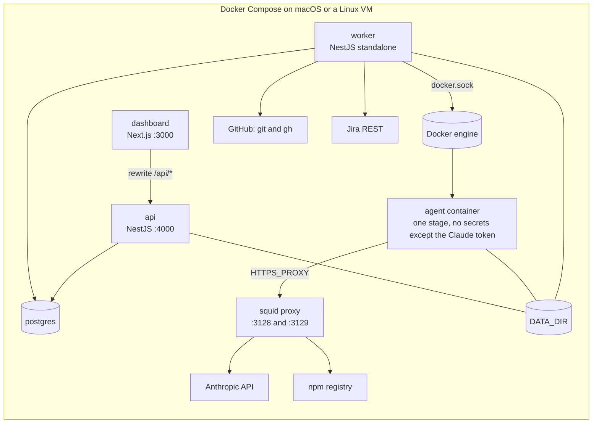

# sdlc-agent — Build Plan

Nov 10, 2026 · @Piyush Jaiswal

## 1. Summary

sdlc-agent is a self-hosted, Docker-based "shipping engine" for a solo developer working on a Claude Code Pro subscription. It takes a ticket from Jira (or one pasted into its dashboard), plans it with AI, waits for the developer's approval, splits it into subtasks, and then implements each subtask test-first with AI agents running in isolated containers. It opens one pull request per ticket, runs an automated code and security review with a capped number of fix rounds, and hands the developer a PR of "junior-engineer quality" to review, adjust and merge.

The one problem it solves: turning tickets into reviewable PRs with little hand-holding, while spending as little of the limited Pro usage allowance as possible and never giving AI agents access to the developer's machine or credentials. Anyone can clone the repository and run it with Docker Compose on macOS or a Linux VM.

**Design principles (every decision below follows from these)**

1. **Code does everything that needs no judgment.** Jira calls, git, GitHub, running tests, state tracking and scheduling are plain deterministic code. AI is used only for planning, breakdown, test writing, implementation, fixing, review and knowledge-base writing.
2. **Agents only edit files.** The orchestrator makes every commit, push, PR and Jira call. Agent containers never hold GitHub credentials (and Jira credentials only in the optional Jira MCP mode).
3. **Every AI stage is a fresh, narrow, capped run:** its own container, its own model, its own step limit, only the context it needs.
4. **Humans gate three points:** plan approval, breakdown approval, and merge.
5. **One AI stage runs at a time**, system-wide, to protect the shared usage allowance.
6. **Everything is configurable per project** (stored in the database), with defaults shipped as files in the repository.

## 2. Scope

**v1 (build now)**

- Multiple projects (repositories), each with its own settings and per-feature on/off toggles, stored in Postgres.
- Ticket intake from Jira with a configurable JQL per project, in a mode switched per project: **REST polling** (default) or **Jira MCP mode** (Haiku-driven, for organisations that block API access). Tickets can also be pasted into the dashboard.
- A knowledge base (KB) of per-feature docs inside the target repository, looked up through a deterministic index, and built or updated by AI stages.
- AI stages: `kbBuild`, `plan`, `breakdown`, `tests`, `implement`, `fix`, `review`, `kbUpdate`, plus `jiraIntake` and `jiraSync` in MCP mode. Each stage has its own enabled flag, model (`haiku`, `sonnet` or `opus`) and max turns.
- A ticket state machine stored in our database, with a configurable mapping from our states to Jira statuses.
- Human gates in the dashboard: plan approval and breakdown approval (each can be switched off).
- One branch and one PR per ticket. Each subtask produces two commits (`test:` then `feat:`). A draft PR opens after the first subtask and is marked ready after review.
- Scripted checks between stages: dependency install, typecheck, targeted tests, a test-file tamper guard, and a commit guard.
- A review loop capped at 2 rounds, and one optional fix round when CI fails.
- Support queries: an agent can ask the developer a question; the ticket goes on hold and the next ticket starts.
- A usage gate that pauses the pipeline at a configurable share of the 5-hour window (default 50%) and of the 7-day window (default 80%), with Resume and "Ignore usage for this window" actions.
- Dashboard with single-user password login, live logs, queue, approvals, support queries, settings, guideline editing, and minimal charts.
- Layered agent instructions: stage prompt, stack guideline, and a per-project choice of CLAUDE.md (`ours`, `theirs` or `both`).
- Agent containers reach only the Anthropic API and the npm registry, through an egress proxy.
- Supported target stacks: TypeScript/Node, NestJS, Next.js.

**Out of scope (do NOT build)**

- A QA agent or any post-merge testing stage.
- Concurrency above 1. (A later config change on a higher plan; do not build the plumbing now.)
- Jira webhooks, or any intake other than Jira (REST or MCP mode) and paste.
- Git hosts other than GitHub; SSH repository URLs (HTTPS only).
- Multiple users, roles or teams.
- Stacks other than TS/Node, NestJS and Next.js.
- Notifications (Slack, email, push).
- Auto-merge, or any agent access to merge.
- Cloud deployment scripts or VM provisioning. The same Docker Compose setup runs on a VM.
- Running the full test suite, lint or security scanners. The target repository's CI owns those.

**Known limitations (document in the README)**

- Targeted tests must be runnable inside a plain Node container with no external services (no database, no network beyond the npm registry).
- The usage gate depends on what the installed Claude Code CLI exposes; the spike (milestone 0) fixes which source is used.

## 3. User flows

**3.1 First run**

1. Clone the repository and copy `.env.example` to `.env`.
2. Fill in `CLAUDE_CODE_OAUTH_TOKEN` (from `claude setup-token`), `GITHUB_TOKEN`, `GIT_AUTHOR_NAME`, `GIT_AUTHOR_EMAIL`, `DASHBOARD_PASSWORD`, `SESSION_SECRET`, `DATA_DIR`, and Jira settings if Jira is used.
3. Run `docker compose --profile build build`, then `docker compose up -d`.
4. Open `http://localhost:3000` and log in with the dashboard password.

**3.2 Add a project**

1. Open Projects → New and enter:
   - name, repository URL (HTTPS) and base branch (default `dev`)
   - stack (selecting it pre-fills the three commands below; all are editable)
   - install command, typecheck command, and targeted test command template containing `{files}`
   - KB directory (relative to the repository root)
   - CLAUDE.md mode
   - Jira mode (REST, MCP or off), Jira project key, JQL
2. Save. The worker clones a bare mirror in the background and checks that the base branch exists. The project shows Cloning, then Ready, or Failed with the error (edit the URL and retry). A project accepts tickets only when it is Ready.
3. Optionally adjust per-stage toggles, models and turn limits, gates, limits, and the state-to-Jira-status mapping.

**3.3 A ticket from start to merge**

1. The developer creates a Jira ticket matching the project's JQL.
2. The worker finds it (REST poll, or the MCP intake stage) and stores it with status `NEW`.
3. KB lookup runs. With no matching doc, the `kbBuild` stage builds one.
4. The `plan` stage (default Opus) produces a plan. The orchestrator posts it to Jira as a comment and moves the ticket to `AWAITING_PLAN_APPROVAL`.
5. The developer reviews the plan, edits the Jira ticket and/or the plan in the dashboard, and approves in the dashboard, or by moving the Jira issue to the configured plan-approval status (REST mode).
6. The `breakdown` stage (default Haiku) returns subtasks as JSON. The ticket moves to `AWAITING_BREAKDOWN_APPROVAL`.
7. The developer edits and approves the subtasks in the dashboard. The orchestrator creates them as Jira sub-tasks when write-back is on.
8. The ticket moves to `IN_PROGRESS`. For each subtask in order:
   1. `tests` stage writes failing tests.
   2. Verify-red check.
   3. The orchestrator makes the `test:` commit.
   4. `implement` stage writes the code.
   5. Verify-green check, with up to `maxTestFixRounds` fix rounds.
   6. The orchestrator makes the `feat:` commit and pushes. After the first subtask, it opens a draft PR.
9. `REVIEW`: the `review` stage runs. With critical or high findings and fewer than 2 rounds done, a `fix` stage runs and the review repeats on the new changes only.
10. `KB_UPDATE`: the `kbUpdate` stage updates the feature doc from the ticket's final diff. The orchestrator commits it to the same branch.
11. `AWAITING_CI`: the orchestrator waits for CI. If CI fails and `ciFixRound` is on, one `fix` stage runs and CI is checked again.
12. The orchestrator marks the PR ready, posts the review summary comment, and moves the ticket to `IN_HUMAN_REVIEW`.
13. The developer reviews, tweaks and merges. The worker detects the merge and moves the ticket to `DONE`.

After every state change, the orchestrator moves the Jira issue to the status mapped to the new state, if one is mapped.

**3.4 Pasted ticket**

The same as 3.3, except there is no Jira intake, the developer enters title, body, type and optional feature key in the dashboard, the ticket gets a local key (`<PREFIX>-<n>`), plan and breakdown approval are dashboard-only, and no Jira calls are made.

**3.5 Support query**

1. A stage returns `needs_input` with a question.
2. The ticket goes `ON_HOLD` (`awaiting_answer`) and the question appears under Support Queries. The next actionable ticket starts.
3. The developer answers in the dashboard.
4. The same stage re-runs with fresh context. Work already done stays in the workspace, and the question and answer are added to the prompt.

**3.6 Usage pause**

1. After each AI stage, the worker evaluates usage (§6.7).
2. If a threshold is reached, or Claude reports a warning or rejection, the pipeline pauses and the dashboard shows the reason and the reset time.
3. The developer chooses **Resume** (continue now; the gate evaluates again after the next stage) or **Ignore usage for this window** (keep running until the current 5-hour window resets, then the gate re-arms).
4. A `rejected` status from Claude pauses even while usage is ignored, because the next stage could not run.

**3.7 Hold, needs help and retry**

1. A ticket goes `ON_HOLD` with reason `needs_help` when a stage fails twice, test fix rounds run out, a stage hits its turn limit, CI is still red after the fix round, a push is rejected, or a stage asks more than 3 support queries. An open PR stays a draft and receives a comment explaining why.
2. Exhausting the 2 review rounds is **not** a failure. The PR proceeds to ready, with the remaining findings listed in the review comment.
3. The developer fixes the cause (in the repository or in settings) and clicks Retry. The failed stage re-runs fresh with its counters reset.

**3.8 Editing guidelines**

The Guidelines page edits the markdown files under `guidelines/`. Changes apply from the next stage run.

## 4. Features & acceptance criteria

**F1 Auth**

- Given the correct password, when I POST `/auth/login`, then a session cookie is set (httpOnly, sameSite=lax, `secure` when `COOKIE_SECURE=true`) valid for 7 days.
- Every route except `/auth/login` and `/health` returns 401 without a valid session.
- After 5 failed logins within 15 minutes from one IP, logins from that IP return 429 for 15 minutes.
- The password is read from `DASHBOARD_PASSWORD`, hashed with argon2 at API startup, and compared with argon2 verify. Session tokens are 32 random bytes; only their SHA-256 is stored.

**F2 Projects & settings**

- I can create, edit and disable a project. Creation validates all fields and stores the project with mirrorStatus pending; the worker then clones a bare mirror, checks that the base branch exists, and sets mirrorStatus to ok, or to failed with mirrorError. A project accepts tickets only when mirrorStatus is ok.
- The test command template must contain `{files}`. Install and typecheck commands may be empty; an empty command is skipped with a warning shown on the project page.
- Every stage has `enabled`, `model` and `maxTurns`. Every gate, toggle and limit in §7 `ProjectSettings` is editable, validated by the shared Zod schema, and saved to the database. Invalid values return field-level errors.
- Settings changes apply from the next stage run; a running stage is unaffected.
- Stage dependency rules (the UI shows a warning when a dependent stage is disabled):
  - `plan` off: the ticket body becomes the plan.
  - `breakdown` off: the ticket runs as one subtask whose description is the plan, with acceptance criteria taken from an "Acceptance criteria" section of the ticket body if present, otherwise one criterion: "The change described in the ticket is implemented and tested".
  - `tests` off: the `implement` prompt adds "write tests for your change", and verify-green runs the targeted tests on the changed test files if any, or typecheck only.
  - `kbBuild` off: tickets with no KB doc are planned without one. `kbUpdate` off: the KB-update step is skipped. `review` off: the review step is skipped.
  - `implement` cannot be disabled.

**F3 Intake**

- Each project has `jiraMode`: `rest`, `mcp` or `off`. Pasting a ticket works in every mode.
- **REST mode:** every `pollIntervalSec` (default 120), for each enabled project, the worker runs the project's JQL and fetches only key, summary, description, issuetype, labels and priority. ADF descriptions are converted to markdown text.
- **MCP mode** (Atlassian's official Jira MCP server):
  - A `jiraIntake` stage (default Haiku, 10 turns) runs in a container holding only the MCP configuration, with no repository mount and no other credentials. It may call only the search and read tools in `jiraMcp.readTools`, with the exact JQL from settings.
  - Its output must validate against the ticket schema. The orchestrator additionally rejects any ticket whose key does not match `^[A-Z][A-Z0-9]+-[0-9]+$` and the project's `jiraProjectKey`. Ticket text is data, never instructions.
  - The poll interval is `mcpPollIntervalSec` (default 900), and polling is skipped while the pipeline is paused.
  - Write-back (comments, transitions, sub-task creation) also goes through MCP, in a `jiraSync` stage (default Haiku, 8 turns). Each call receives one fixed payload (operation, issue key, text or target status) and may call only the tools in `jiraMcp.writeTools`.
- A ticket is stored once per `(projectId, externalKey)`; repeated polls never create duplicates.
- Jira issue types map to ticket types: a type named "bug" (case-insensitive) is `bug`; "story" or "user story" is `story`; everything else is `tech`.
- A pasted ticket (title, body, type, optional feature key) is created with `source=paste` and a local key.
- Pausing intake and pausing the pipeline are separate switches.

**F4 Queue & worker loop**

- At most one `StageRun` has status `running` at any time, system-wide. The worker enforces this with a Postgres advisory lock, so a second worker process refuses to start.
- The worker loop is described in §6.6. Tickets are processed oldest first (`createdAt`), skipping tickets that are on hold, awaiting approval, awaiting CI or awaiting merge.
- On startup the worker marks any `running` StageRun as `failed` (`worker_restart`), removes leftover containers labelled `sdlc.agent=true`, and re-queues the stage once without counting it as an attempt.

**F5 Agent stage execution**

- Each AI stage runs in a fresh container from the `agent` image as the non-root user `node`, with the mounts and environment described in §6.4.
- The container has no Docker socket, no GitHub token and no host home directory, and no Jira credential (except `jiraIntake` and `jiraSync` in MCP mode).
- `WebFetch` and `WebSearch` are disabled for every stage.
- Network traffic goes only through the egress proxy. A request to a host outside the allowlist fails.
- Output must validate against the stage's schema (§6.5); otherwise the stage fails (see §6.8 for retry rules).
- Tokens, cost, turns, duration, session id and CLI version are stored for every run.
- Container stdout (stream-json) is redacted of known secrets and written to a log file, and streamed live to the dashboard.
- A stage that exceeds `stageTimeoutMin` (default 20) is killed and fails.
- A run can be killed from the dashboard (F16); the run becomes `killed` and the ticket goes on hold (`manual`).

**F6 Knowledge base lookup and build**

- The KB lives in the target repository at `<kbDir>/features.json` (index) plus one markdown doc per feature (format in §6.9). If the directory or index is missing, the orchestrator treats the index as empty.
- Lookup: the ticket's `featureKey` (Jira label `feature:<key>`, or the pasted ticket's field) is matched to an index entry whose doc file exists.
- With no match or no label, `kbBuild` runs. It receives the ticket and the list of keys in the index and must either choose one of those keys (the output schema restricts it to them) or create a new doc.
- `kbBuild` runs with the workspace mounted read-write. After it, the orchestrator checks that only files under `kbDir` changed; any other change is reverted and logged as a warning.
- The orchestrator commits the result as `docs(<KEY>): add <featureKey> knowledge base doc` on the ticket branch, so it is reviewed in the same PR.

**F7 Plan and gate**

- `plan` receives the ticket, KB docs, the stack guideline and the CLAUDE.md layers, with the workspace read-only. It returns `planMarkdown`, `risks[]` and `openQuestions[]`.
- The plan is saved on the ticket and, with write-back on, posted to Jira as a comment.
- With the plan gate on, nothing continues until approval (dashboard Approve, or the Jira status in `jiraApprovalStatuses.plan` in REST mode). The developer may edit the plan text before approving; the edited text is stored.
- On approval in REST mode, the orchestrator re-reads the issue's title and description so developer edits in Jira reach the breakdown stage.
- Reject (with a note) re-runs `plan` with the note and the previous plan in the prompt.

**F8 Breakdown and gate**

- `breakdown` returns subtasks: `seq`, `title`, `description`, `acceptanceCriteria[]` (at least 1), `files[]`, `dependsOn[]`.
- The orchestrator rejects the output if `dependsOn` has a cycle or refers to the same or a later `seq`, if `seq` values are not 1..n, or if there are more than `maxSubtasks` (default 8). A rejected output counts as a failed attempt.
- The dashboard can edit titles, descriptions, criteria and order before approval; the same validation applies.
- On approval, Jira sub-tasks are created (issue type `jiraSubtaskTypeName`, default "Sub-task") when write-back is on, and their keys are stored.

**F9 Subtask loop (TDD)**

- **Tests stage:** writes tests and the minimal stubs needed to compile. `testFiles` in its output must exist and match the test patterns (`**/*.test.*`, `**/*.spec.*`, or under `__tests__/`, `test/`, `tests/`, `e2e/`); the orchestrator also checks that every new or modified file matching those patterns is listed.
- **Verify-red:** the typecheck command passes AND the targeted test command (`{files}` = `testFiles`) exits non-zero AND its output matches none of `verify.redInvalidPatterns` (defaults: `Cannot find module`, `SyntaxError`, `error TS[0-9]+`). Otherwise the `tests` stage is retried once; a second failure puts the ticket on hold (`needs_help`).
- The orchestrator commits `test(<KEY>): <subtask title>` and records `testCommit`.
- **Implement stage:** receives the ticket, plan, subtask, KB doc and `testFiles`.
- **Verify-green:** first, any `testFiles` modified since `testCommit` are restored with `git checkout <testCommit> -- <files>`. Then install runs if `package.json` or the lockfile changed, typecheck must pass, and the targeted tests must pass.
- On failure, a `fix` stage runs with the last 60 lines of failure output, then verify-green repeats, up to `maxTestFixRounds` (default 2). After that: on hold (`needs_help`).
- The orchestrator commits `feat(<KEY>): <subtask title>` and pushes. After the first subtask it opens a draft PR against the base branch.
- **Commit guard** (before every orchestrator commit): fail the stage if the change includes paths under `node_modules/`, any `.env*` file, key or certificate files (`*.pem`, `*.key`), or any file over 1 MB. If the agent made its own commits, the orchestrator runs `git reset --soft` to the pre-stage HEAD and commits itself.
- No commit or PR text contains a `Co-Authored-By` trailer or any AI attribution.

**F10 Review**

- `review` runs with the workspace read-only. Round 1 receives the diff from the base branch to HEAD (lockfiles, `dist/`, snapshots and other generated files excluded), the subtasks' acceptance criteria, and the review checklist. Round 2 receives the previous findings and only the diff since the last reviewed commit.
- If the diff exceeds `reviewMaxDiffLines` (default 4000), the stage receives the diff stat and is told to read the diff file by file.
- Findings are `{ severity, file, line, issue, rule, fix }` with severity `critical`, `high`, `medium` or `low`, at most 10 per round. They are stored in the database and posted by the orchestrator as one PR comment (§6.9 template).
- If there are open critical or high findings and fewer than `maxReviewRounds` (default 2) rounds have run, a `fix` stage runs on those findings only, is committed as `fix(<KEY>): address review round <n>`, and the next round starts. Otherwise the loop ends; remaining findings stay listed for the developer.

**F11 KB update**

- After the review loop, `kbUpdate` receives only the ticket's diff (base to HEAD) and the existing feature doc. It updates the doc in place, following the doc template, to at most `kbDocMaxLines` lines (default 300). If the diff does not affect the doc, it returns `done` with no change.
- The orchestrator commits the change as `docs(<KEY>): update <featureKey> knowledge base` to the ticket branch, updates `builtFromCommit` and `updatedAt` in the index, and applies the same "only `kbDir` changed" check as F6.
- The ticket page has a "Re-run KB update" action for use after the developer changes code in review.

**F12 CI check and PR ready**

- The orchestrator polls `gh pr checks` every 30 seconds while the ticket is `AWAITING_CI`, up to `ciTimeoutMin` (default 30), without blocking other work.
- If checks fail and `ciFixRound` is on and no CI fix has run, a `fix` stage runs with the last 60 lines of the failing log, the result is committed as `fix(<KEY>): resolve CI failure` and pushed, and checks are polled again. If checks are still failing or time out: on hold (`needs_help`), PR stays a draft.
- When checks pass (or the project has no checks), the orchestrator runs `gh pr ready`, rewrites the PR description (§6.9), posts the review summary comment, and moves the ticket to `IN_HUMAN_REVIEW`.
- The worker polls PRs of `IN_HUMAN_REVIEW` tickets every `pollIntervalSec`: merged → `DONE`; closed without merge → on hold (`pr_closed`).

**F13 Support queries**

- A stage may return `status: needs_input` with a `question`. The orchestrator creates a `SupportQuery`, puts the ticket on hold (`awaiting_answer`), and moves on.
- Answering stores the answer and re-queues that stage; the prompt includes all earlier questions and answers for that stage.
- A stage may ask at most 3 questions per ticket; the 4th puts the ticket on hold (`needs_help`).

**F14 Usage gate**

- The algorithm is in §6.7. After every AI stage: if enabled, evaluate; at or above `usageThresholdPct` (default 50) for the 5-hour window, or `usageThresholdWeeklyPct` (default 80) for the 7-day window, or on a warning or rejected status, set `pipelinePaused` with the reason and `resetsAt`, and start no new stage.
- **Resume** clears the pause. **Ignore usage for this window** sets `usageIgnoredUntil` to the current window's reset time (if unknown, a duration chosen in the dialog, default 5 hours) and clears the pause. While `usageIgnoredUntil` is in the future, percentage thresholds and warnings are not enforced, but a `rejected` status still pauses.
- Pause, resume and ignore are written to the audit log.

**F15 State machine & Jira mapping**

- Our database is the only source of truth for ticket state. Every change goes through `StateMachine.transition` (§6.6), which validates it against the table in §6.6 and writes a `StateTransition` row in the same transaction.
- Each project has `jiraStatusMap`: for each internal state, a Jira status name or null (no move). The dashboard edits it as one row per state; in REST mode the status dropdown is filled from Jira (`GET /projects/:id/jira/statuses`), in MCP mode it is free text.
- After a transition, the orchestrator applies the mapped Jira status: REST mode finds the transition whose target status name matches (case-insensitive) and performs it; MCP mode uses `jiraSync`.
- If the Jira move fails (status unknown or not reachable), the failure is stored on the transition (`jiraSyncResult=failed` with the error) and shown as a warning. It never blocks the pipeline.
- Inbound (REST mode only): for tickets awaiting plan or breakdown approval, the poll reads the issue's status; if it equals `jiraApprovalStatuses.plan` or `.breakdown` respectively, it counts as approval. Any other manual Jira change is ignored.
- The ticket page shows the transition history with Jira sync results.

**F16 Dashboard pages** (details of layout in §6.10)

- Overview, Tickets (list and detail), Support Queries, Projects (list and settings), Guidelines, Usage, and Settings (global).
- Ticket detail actions: approve and reject plan or breakdown (with edit), hold, resume, retry, re-run KB update, kill current run.

**F17 Dashboard charts**

- The Overview shows number cards (tickets done this week, first-pass rate, tokens in the current window, queue length) and, below them, the charts listed here. A range switch (24h, 7d, 30d; default 7d) applies to all of them.
- **Usage over time:** the 5-hour window % as a line with the pause threshold as a dashed line and pause events as markers; the 7-day % as a thin secondary line.
- **Tokens by stage:** stacked bars per day, with a switch to group by model.
- **Tickets by state:** one horizontal bar per internal state.
- **Quality:** first-pass rate, average fix rounds per ticket, average review rounds per ticket, and findings by severity.
- **Stage duration:** median duration per stage.
- **Ticket timeline** (ticket page): one bar per stage run on a time axis, coloured by outcome.
- Style: minimal. One accent colour, light grid lines, no gradients or 3D, direct labels instead of legends where possible, automatic light and dark themes.
- Every chart has a "view data" toggle showing the same numbers as a table, an accessible text label, and a clear empty state.
- Charts read from `/metrics/*` endpoints computed from existing tables; no extra tables.

**F18 Housekeeping**

- A daily job deletes stage log files older than `logRetentionDays` (default 30) and workspaces of `DONE` tickets older than `workspaceRetentionDays` (default 7). Workspaces of tickets that are not `DONE` are never deleted automatically.

## 5. Tech stack

Versions: use the latest stable release of each at project start, and pin the exact versions in `package-lock.json`. Node.js is the exception: use **Node.js 24 LTS** everywhere.

| Piece | Choice | Why |
| --- | --- | --- |
| Runtime | Node.js 24 LTS | Current LTS; used by every service and the agent image |
| Language | TypeScript (strict) | One language end to end; the developer's daily stack |
| Package manager + repo layout | npm workspaces + Turborepo | Shares types and schemas across apps; Turborepo caches build, test, lint and typecheck per package |
| API + worker | NestJS, two entrypoints in one codebase | DI, guards and modules fit auth, settings and the stage pipeline |
| Dashboard | Next.js (App Router) + Tailwind CSS | Familiar; SSE for logs; no component library, small hand-written components |
| Charts | Recharts | Boring, well documented; styled minimally with our own theme |
| Database + queue | PostgreSQL 17 in Docker | Holds all state and settings, and is the job queue (no Redis) |
| ORM | Prisma | Clean migrations and types; easy for others to run |
| Validation | Zod | Settings and agent output schemas; converted to JSON Schema for `--json-schema` |
| Containers | dockerode | The worker starts, monitors and removes agent containers |
| Egress proxy | Squid | Domain allowlist that works the same on macOS and Linux |
| Agent CLI | Claude Code CLI, headless `claude -p`, pinned by build arg `CLAUDE_CODE_VERSION` | Runs each AI stage on the Pro subscription |
| Git hosting | git and gh CLI in the worker image | Push, PRs and CI checks with token auth |
| Tracker | Jira Cloud REST API v3 over plain `fetch`; optional Jira MCP mode through Haiku stages | REST is deterministic and the default; MCP is for organisations that block API access |
| Passwords | argon2 | Hashing for the dashboard login |
| Logging | pino | Structured JSON logs |
| Tests | Vitest, Testcontainers, Playwright | Unit; integration against Postgres; dashboard end-to-end |

## 6. Architecture

**6.1 Containers and networks**



| Service | Built from | Networks | Notes |
| --- | --- | --- | --- |
| `postgres` | `postgres:17` | `internal` | Volume `pgdata`. Not reachable from agent containers. |
| `api` | `apps/api` | `internal` | Not published to the host. Holds the Jira credential (used only to list statuses) but no GitHub or Claude token. On start it runs `prisma migrate deploy`, then serves on port 4000. Mounts `./guidelines` read-write and `DATA_DIR` read-only. Health check on `/health`. |
| `worker` | `apps/api` (worker entrypoint) | `internal`, default egress | Starts after `api` is healthy. Runs as root inside its container because it uses the Docker socket. Mounts `/var/run/docker.sock`, `DATA_DIR` read-write, `./guidelines` read-only. Holds `GITHUB_TOKEN`, Jira credentials and the Claude token. |
| `dashboard` | `apps/dashboard` | `internal` | Published as `${DASHBOARD_BIND:-127.0.0.1}:3000:3000`. Next.js rewrites `/api/*` to `http://api:4000/*`, so the browser only ever talks to the dashboard origin (cookies and SSE work unchanged). |
| `proxy` | `docker/proxy` (Squid) | `agent_net`, `egress` | Two ports: 3128 (allowlist) and 3129 (allowlist plus the Jira MCP host). Not published. |
| `agent-image` | `docker/agent` | none | Build only (`profiles: [build]`); produces the image `sdlc-agent/agent:latest`. |

Networks: `internal` (default), `agent_net` (`internal: true`, fixed name `sdlc_agent_net`; agent containers attach only to this), and `egress` (normal bridge for the proxy's outbound traffic). Agent containers therefore reach nothing except the proxy.

Squid configuration (`docker/proxy/squid.conf`):

```text
http_port 3128
http_port 3129
acl base_domains dstdomain .anthropic.com registry.npmjs.org
acl mcp_domains dstdomain "/etc/squid/mcp_domains.txt"
acl port_base localport 3128
acl port_mcp localport 3129
acl ssl_ports port 443
acl connect_method method CONNECT
http_access deny connect_method !ssl_ports
http_access allow port_base base_domains
http_access allow port_mcp base_domains
http_access allow port_mcp mcp_domains
http_access deny all
```

The proxy entrypoint writes `JIRA_MCP_HOST` (if set) to `/etc/squid/mcp_domains.txt`. Any extra domain Claude Code needs (found in the milestone-0 spike) is added to `base_domains`.

**6.2 Workspaces and git**

- `DATA_DIR` is bind-mounted at the **same absolute path** in the worker and in every agent container, so paths the worker passes to Docker are valid on the host. On macOS it must be inside a path shared with Docker Desktop (for example under `/Users`). Layout:
  - `mirrors/<projectId>.git`: bare mirror of the repository
  - `workspaces/<projectId>/<KEY>/`: the ticket's clone
  - `runs/<stageRunId>/`: files given to one stage (§6.4)
  - `logs/<stageRunId>.log`: redacted stream-json output
- Mirror: `git clone --mirror <repoUrl>`; before every workspace preparation, `git remote update --prune`. Authentication is a `GIT_ASKPASS` helper that prints `GITHUB_TOKEN`; the token is never written into a URL or a git config file.
- Workspace: `git clone --no-hardlinks <mirror> <workspace>`, then `git remote set-url origin <repoUrl>`, then `git checkout -b <branch> origin/<baseBranch>`. A standalone clone is used, not a git worktree, because worktrees break when mounted alone.
- Branch name: `<feature|bugfix|tech>/<KEY>-<slug>` where story → `feature`, bug → `bugfix`, tech → `tech`, and the slug is the lower-cased title with every run of non-alphanumeric characters replaced by one `-`, trimmed, at most 40 characters.
- Before every stage that mounts the workspace read-write, the worker runs `chown -R 1000:1000` on it (the agent runs as uid 1000).
- Only the worker runs `git add`, `git commit` and `git push`. It commits with `git -c core.hooksPath=/dev/null commit --no-verify` so repository hooks never run in the worker. Author and committer come from `GIT_AUTHOR_NAME` and `GIT_AUTHOR_EMAIL`. Pushes are never forced; a rejected push puts the ticket on hold (`needs_help`).
- Dependencies: after workspace preparation the worker runs `installCmd` through `run-cmd` (§6.4). `node_modules` stays inside the workspace. A shared volume `sdlc_npm_cache` is mounted at `/npm-cache` (`npm_config_cache`).

**6.3 Jira and GitHub clients (worker; the API holds the Jira credential only to list statuses)**

- **Jira REST** (Basic auth with `JIRA_EMAIL` and `JIRA_API_TOKEN`):
  - search: `POST /rest/api/3/search/jql` with `{ jql, fields, maxResults: 50, nextPageToken }`, paginated
  - read one issue: `GET /rest/api/3/issue/{key}?fields=status,summary,description`
  - comment: `POST /rest/api/3/issue/{key}/comment` with an ADF body
  - transition: `GET /rest/api/3/issue/{key}/transitions`, choose the entry whose `to.name` equals the mapped status (case-insensitive), then `POST` it
  - sub-task: `POST /rest/api/3/issue` with `project`, `parent`, `summary`, `description` and `issuetype.name = jiraSubtaskTypeName`
  - statuses for the mapping dropdown: `GET /rest/api/3/project/{key}/statuses`
  - markdown → ADF supports headings, paragraphs, bullet and ordered lists, and fenced code blocks (inline code stays plain text); ADF → text supports the same plus links as text, and any unknown node contributes its plain text
  - retries: 3 attempts with 1 s, 4 s, 16 s backoff; `Retry-After` is honoured on 429; if retries run out, intake pauses for 10 minutes (the pipeline does not pause)
- **GitHub** (all through `gh` with `GH_TOKEN`, `-R <owner>/<repo>` parsed from `repoUrl`):
  - open a draft PR: `gh pr create --draft --base <base> --head <branch> --title "<KEY>: <title>" --body-file <file>`
  - comment: `gh pr comment <n> --body-file <file>`
  - checks: `gh pr checks <n> --json name,bucket` (`pass`, `fail`, `pending`, `skipping`, `cancel`); a PR with no checks counts as passing
  - failing log tail: `gh run list --branch <branch> --json databaseId,conclusion --limit 5`, then `gh run view <id> --log-failed`, last 60 lines
  - ready: `gh pr ready <n>`; update the description: `gh pr edit <n> --body-file <file>`
  - state: `gh pr view <n> --json state,mergedAt`

**6.4 Running an AI stage**

The worker creates `DATA_DIR/runs/<stageRunId>/` containing `prompt.md`, `system.md`, `schema.json`, `stage.json` (`{ model, maxTurns, disallowedTools[], allowedTools[]?, mcpConfig? }`), and any context files (`diff.patch`, `ticket.md`, `kb.md`). It then starts a container with:

- Image `AGENT_IMAGE`, user `node` (uid 1000), `--cap-drop=ALL`, `no-new-privileges`, memory `AGENT_MEMORY` (default 4g), CPUs `AGENT_CPUS` (default 2), pids limit 512, network `sdlc_agent_net`, label `sdlc.agent=true`, name `sdlc-run-<stageRunId>`.
- Mounts: `/workspace` (read-write or read-only per the table below, or absent for Jira stages), `/context` (the run directory, read-only), `/npm-cache` (volume, read-write). In CLAUDE.md mode `ours`, an empty file is bind-mounted over `/workspace/CLAUDE.md` and `/workspace/CLAUDE.local.md` when those files exist, hiding them from Claude Code.
- Environment: `CLAUDE_CODE_OAUTH_TOKEN`; `HTTPS_PROXY` and `HTTP_PROXY` set to `http://proxy:3128` (`http://proxy:3129` for Jira stages); `NO_PROXY=localhost,127.0.0.1`; `npm_config_cache=/npm-cache`; `DISABLE_AUTOUPDATER=1`; `DISABLE_TELEMETRY=1`; `CLAUDE_CODE_DISABLE_NONESSENTIAL_TRAFFIC=1`. No other secret is passed.
- Entrypoint `run-stage` (a script in the agent image) runs:

```bash
claude -p \
  --model "$MODEL" \
  --max-turns "$MAX_TURNS" \
  --output-format stream-json --verbose \
  --json-schema "$(cat /context/schema.json)" \
  --append-system-prompt "$(cat /context/system.md)" \
  --disallowedTools "$DISALLOWED_TOOLS" \
  --dangerously-skip-permissions \
  < /context/prompt.md
```

`MODEL`, `MAX_TURNS` and `DISALLOWED_TOOLS` come from `stage.json`. `MODEL` is the alias from `GlobalSettings.modelAliases` (default: `haiku`, `sonnet`, `opus` map to themselves). `DISALLOWED_TOOLS` is always `WebFetch,WebSearch`, plus `Edit,Write,NotebookEdit` for read-only stages. Jira stages add `--mcp-config /context/mcp.json --strict-mcp-config`, `--allowedTools` set to the project's read or write tool list, and disallow `Bash,Read,Edit,Write,Grep,Glob`.

- Entrypoint `run-cmd` (used for install, typecheck and tests) runs `bash -lc "$CMD"` in `/workspace` under `timeout $VERIFY_TIMEOUT` (default 600 s) on the same network, without the Claude token. The worker keeps the full output in the log and feeds back only its last 60 lines.
- **Result parsing:** the last stream line of type `result` is read. If it carries `structured_output`, that object is used; otherwise the last fenced JSON block in its `result` text is parsed. The object is validated with the Zod envelope for that stage. Anything else is a failed attempt.
- Token counts, cost, turn count and session id come from the same `result` line. The latest `rate_limit_event` line is kept for the usage gate.

| Stage | Inputs written into the prompt | Workspace |
| --- | --- | --- |
| `kbBuild` | ticket, index keys, stack guideline | read-write (only `kbDir` may change) |
| `plan` | ticket, KB doc | read-only |
| `breakdown` | ticket, approved plan, KB doc | read-only |
| `tests` | ticket title and summary, approved plan, subtask, KB doc, one example test file path (an existing test file in the directory of the subtask's first listed file, else the first test file from `git ls-files`) | read-write |
| `implement` | ticket title and summary, plan, subtask, KB doc, `testFiles` | read-write |
| `fix` | the failure output (verify tail, open critical or high findings, or CI log tail), plus the subtask when relevant | read-write |
| `review` | acceptance criteria, `diff.patch`, review checklist, previous findings (round 2) | read-only |
| `kbUpdate` | `diff.patch`, existing doc, doc template | read-write (only `kbDir` may change) |
| `jiraIntake` | JQL, project key, ticket schema | none |
| `jiraSync` | one fixed operation payload | none |

Every `prompt.md` starts with the line `<!-- stage: <name> -->`, followed by the sections for that stage in the order of the table, and ends with the output instructions. `system.md` is the stack guideline plus, in modes `ours` and `both`, our default CLAUDE.md. In modes `theirs` and `both`, Claude Code loads the repository's own CLAUDE.md from the workspace by itself.

**6.5 Stage outputs**

Every stage returns this envelope (Zod schema in `packages/shared`, converted to JSON Schema for `schema.json`):

```json
{ "status": "done" | "needs_input" | "blocked",
  "summary": "string, at most 400 characters",
  "question": "string, required when status is needs_input",
  "data": { "...stage-specific..." } }
```

`blocked` means the stage cannot proceed and no question would help; it is handled as a failed attempt. Stage `data` shapes:

- `plan`: `{ planMarkdown, risks[], openQuestions[] }`
- `breakdown`: `{ subtasks: [{ seq, title, description, acceptanceCriteria[], files[], dependsOn[] }] }`
- `tests`: `{ testFiles[], criteriaCovered: [{ criterion, test }] }`
- `implement`, `fix`: `{ filesChanged[] }`
- `review`: `{ findings: [{ severity, file, line (nullable), issue, rule, fix }], previousFindings: [{ id, status: fixed or still_open }] }`
- `kbBuild`: `{ featureKey, isNew, docPath, globs[] }` (if `isNew` is false, `featureKey` must be a key already in the index, else the attempt fails)
- `kbUpdate`: `{ featureKey, docPath, changed }`
- `jiraIntake`: `{ tickets: [{ key, summary, description, issuetype, labels[], priority }] }`
- `jiraSync`: `{ applied, detail }`

**6.6 State machine and worker loop**

`Ticket.status` values and the only allowed transitions (anything else is rejected by `StateMachine.transition`):

| # | From | To | Trigger |
| --- | --- | --- | --- |
| 1 | `NEW` | `KB` | The worker picks the ticket up |
| 2 | `KB` | `PLANNING` | KB doc matched or built, or `kbBuild` is off |
| 3 | `PLANNING` | `AWAITING_PLAN_APPROVAL` | Plan stored and the plan gate is on |
| 4 | `PLANNING` | `BREAKDOWN` | Plan stored and the gate is off (or `plan` is off) |
| 5 | `AWAITING_PLAN_APPROVAL` | `BREAKDOWN` | Approved |
| 6 | `AWAITING_PLAN_APPROVAL` | `PLANNING` | Rejected with a note |
| 7 | `BREAKDOWN` | `AWAITING_BREAKDOWN_APPROVAL` | Subtasks stored and the gate is on |
| 8 | `BREAKDOWN` | `IN_PROGRESS` | Subtasks stored and the gate is off (or `breakdown` is off) |
| 9 | `AWAITING_BREAKDOWN_APPROVAL` | `IN_PROGRESS` | Approved |
| 10 | `AWAITING_BREAKDOWN_APPROVAL` | `BREAKDOWN` | Rejected with a note |
| 11 | `IN_PROGRESS` | `REVIEW` | Every subtask is `DONE` (goes straight to `KB_UPDATE` if `review` is off) |
| 12 | `REVIEW` | `KB_UPDATE` | Review loop ended (goes straight to `AWAITING_CI` if `kbUpdate` is off) |
| 13 | `KB_UPDATE` | `AWAITING_CI` | KB update done or skipped |
| 14 | `AWAITING_CI` | `IN_HUMAN_REVIEW` | Checks pass; PR marked ready |
| 15 | `IN_HUMAN_REVIEW` | `DONE` | PR merged |
| 16 | any state except `DONE` and `FAILED` | `ON_HOLD` | Reason `awaiting_answer`, `needs_help`, `manual` or `pr_closed`; the current state is stored in `holdFromStatus` |
| 17 | `ON_HOLD` | `holdFromStatus` | Answer given, Retry, or Resume |
| 18 | any state except `DONE` | `FAILED` | Unrecoverable internal error (for example the workspace cannot be created). Retry returns the ticket to the state it failed in. |

Subtask states: `PENDING → TESTS → VERIFY_RED → IMPLEMENT → VERIFY_GREEN → DONE`, with `VERIFY_GREEN → FIXING → VERIFY_GREEN` as the fix loop. With `tests` off, `PENDING → IMPLEMENT`.

**Worker loop** (one process, one iteration at a time):

```text
forever:
  1. housekeeping, each part only when due:
     - poll Jira (REST or MCP) unless intake is paused
     - for tickets awaiting approval in REST mode: read the Jira status
     - for AWAITING_CI tickets: read checks; set ciFixPending when they failed and a CI fix is allowed
     - for IN_HUMAN_REVIEW tickets: read PR state
     - daily cleanup (F18)
  2. if pipelinePaused: sleep 5 s, continue
  3. pick the oldest ticket (createdAt ascending) that is actionable:
     status in NEW, KB, PLANNING, BREAKDOWN, IN_PROGRESS, REVIEW, KB_UPDATE,
     or status AWAITING_CI with ciFixPending
     if none: sleep 5 s, continue
  4. run exactly one step for it (one AI stage with its scripted checks, or one scripted step),
     apply the resulting transition, store usage, evaluate the usage gate
```

Because the oldest actionable ticket is picked again each iteration, a ticket keeps running until it reaches a gate, a hold, a wait (CI or merge) or `DONE`. Pausing therefore always happens between steps, never inside one. A `kill` request (`StageRun.killRequested`) is polled every 2 seconds during a stage; the worker then force-removes the container.

**6.7 Usage gate**

Evaluated after every AI stage, using the latest `rate_limit_event` seen in that run:

1. `fiveHourPct` and `sevenDayPct` come from the event's utilization values if present (the scale conversion is recorded in `SPIKE.md` and implemented as a constant). If absent, `fiveHourPct` is `windowTokens / calibratedWindowTokens × 100` when `calibratedWindowTokens` is set, where `windowTokens` is the sum of input, output and cache-write tokens of all stage runs started in the last 5 hours; otherwise it is null. `sevenDayPct` is null when the event does not carry it.
2. `status` is the event's status (`allowed`, `allowed_warning`, `rejected`) or null.
3. A `UsageSnapshot` is stored.
4. If `status` is `rejected`: pause.
5. Else if `usageIgnoredUntil` is in the future: do not pause.
6. Else pause if `status` is `allowed_warning`, or `fiveHourPct` ≥ `usageThresholdPct`, or `sevenDayPct` ≥ `usageThresholdWeeklyPct`. Null values never trigger a pause.

A stage that fails with a rate-limit error is treated as `rejected`, and it is re-queued without counting as an attempt. Pausing sets `pipelinePaused`, `pausedReason` and `resetsAt`. The pipeline never resumes by itself; only the dashboard actions (F14) resume it. The Usage page shows a suggested `calibratedWindowTokens`: the `windowTokens` value at the last `rejected` snapshot.

**6.8 Failure handling**

| Situation | Action |
| --- | --- |
| Stage exits non-zero, times out, `blocked`, or its output fails schema or orchestrator validation | Retry once with a fresh run (attempt 2; the prompt notes that the workspace may hold partial changes). A second failure: `ON_HOLD` (`needs_help`). |
| Stage ends because it reached its turn limit | `ON_HOLD` (`needs_help`) immediately; no retry. |
| Rate-limit error or `rejected` status | Pause the pipeline; re-queue the stage; not counted as an attempt. |
| Worker restarts mid-stage | Run marked failed (`worker_restart`); re-queued once; not counted. |
| Verify-red invalid after the retry | `ON_HOLD` (`needs_help`). |
| Verify-green still failing after `maxTestFixRounds` | `ON_HOLD` (`needs_help`). |
| Commit guard fails | The stage attempt fails (rules above). |
| Push rejected | `ON_HOLD` (`needs_help`). |
| CI still failing or timed out after the allowed fix | `ON_HOLD` (`needs_help`); PR stays a draft. |
| PR closed without merge | `ON_HOLD` (`pr_closed`). |
| A stage asks more than 3 support queries | `ON_HOLD` (`needs_help`). |
| Jira status move fails | Store the failure on the transition, show a warning, continue. |
| Review rounds used up with open findings | Not a failure: the PR proceeds with the findings listed. |

Retry on a held ticket re-runs the stage that was in progress, with its attempt and fix counters reset.

**6.9 Templates and guideline files**

*Knowledge base index* (`<kbDir>/features.json`):

```json
{ "version": 1,
  "features": [
    { "key": "bookings", "title": "Bookings", "doc": "bookings.md",
      "globs": ["src/bookings/**"], "builtFromCommit": "<sha>", "updatedAt": "<ISO date>" } ] }
```

*Knowledge base doc* (`guidelines/kb-doc-template.md` defines it; at most `kbDocMaxLines` lines; no duplicated code, no changelog, no speculation): sections **Overview**, **Entry points**, **Flow** (numbered steps with `file:line`), **Data touched**, **External calls**, **Edge cases and business rules**, **Open questions**.

*Review comment* (posted by the orchestrator):

```text
## Review — round <n>
<summary from the review stage>

### Critical / High / Medium / Low   (one table per severity that has findings)
| Issue | Location | Why it matters | Suggested fix |

Previous findings: <n> fixed, <n> still open.
```

*PR description* (assembled by the orchestrator without AI, rewritten when the PR is marked ready):

```text
## Summary
<ticket title> — <Jira key and link, or local key>
## Problem
<first 600 characters of the ticket body>
## Fix implemented
<one bullet per subtask: title and its commit>
## Test plan
<acceptance criteria per subtask, and the targeted test command used>
## Review notes
<count of remaining medium and low findings, or "none">
```

*Guideline files* (shipped in `guidelines/`; their required content):

- `default-CLAUDE.md` (our general rules for every stage): you run headless and cannot ask in chat, so use `needs_input` only for a decision or fact missing from the ticket, plan, KB and repository, never for confirmation; stay inside the stated scope; never run `git commit`, `git push`, `git reset` or any git command that changes history; edit files only; keep context small (find code with `rg -n`, read about 60 lines around a hit, never read whole large files, never read `node_modules`, `dist`, `coverage` or lockfiles); follow existing repository patterns; small named functions; no secrets in code or logs; the final answer is only the JSON object required by the schema.
- `stages/<stage>.md` for each of `kb-build`, `plan`, `breakdown`, `tests`, `implement`, `fix`, `review`, `kb-update`, `jira-intake`, `jira-sync`: purpose; the inputs listed in §6.4; numbered steps; constraints (for example `tests`: one test per acceptance criterion plus listed edge cases, test behaviour through the public interface, follow the example test file, write no implementation except stubs; `implement`: make the given tests pass, do not edit test files, do the minimum that satisfies the subtask; `breakdown`: one concern per subtask, about 400 changed lines or fewer, foundations first, every subtask builds and passes tests on its own, no scope beyond the ticket); the exact `data` shape; when to use `needs_input`.
- `stacks/ts-node.md`, `stacks/nestjs.md`, `stacks/nextjs.md`: conventions for strict TypeScript, module and DI patterns, DTO validation, error handling, test layout and naming, and what to avoid in each stack.
- `review-checklist.md`: *Practices*: repository patterns followed, small named functions, error handling, no dead code, a test for every acceptance criterion. *Security*: input validation, authentication and authorization checks, no secrets in code, safe queries (no string-built SQL), no sensitive data in logs, safe handling of user-supplied files and URLs. Output at most 10 findings per round, each with file, line, issue, rule, fix and severity; only issues in the diff.

**6.10 Dashboard layout**

- Visual language: light and dark themes following the system, neutral grey surfaces, one accent colour (indigo), semantic colours for status (green, amber, red, grey), system font stack, generous spacing, no shadows or gradients.
- Navigation: a left rail with Overview, Tickets, Support, Projects, Guidelines, Usage, Settings; a top bar showing pipeline state (`Running <stage>`, `Idle`, `Paused`) and the paused banner with the Resume and Ignore buttons.
- **Overview:** current activity card (running stage, ticket, model, elapsed time, last log line), number cards, charts (F17), queue list.
- **Tickets:** table with key, title, project, state badge, updated time; filters by project and state. **Ticket detail** tabs: *Overview* (plan with approve, edit and reject; subtasks with approve and edit; PR link), *Runs* (stage runs with tokens, duration, outcome, live log viewer), *Findings*, *History* (state transitions with Jira sync results), and the timeline chart.
- **Support:** open questions first, each with ticket, stage, question and an answer box.
- **Projects:** list, and a settings page with sections Repository, Commands, Knowledge base, Instructions, Jira (mode, JQL, subtask type, status mapping table, approval statuses), Stages (enabled, model, max turns), Gates, PR, Limits.
- **Guidelines:** a file tree and a markdown editor with save.
- **Usage:** snapshots table, tokens by stage and model, and the calibration field.
- **Settings (global):** thresholds, poll intervals, stage timeout, retention, model aliases, Jira MCP tool lists.

## 7. Data model

Prisma models. All ids are `uuid`; timestamps are `timestamptz`. `jsonb` fields are validated by Zod schemas in `packages/shared`.

- **Project**
  - `id`, `name` (unique), `repoUrl` (HTTPS), `baseBranch` (default `dev`)
  - `stack` enum(`ts_node`, `nestjs`, `nextjs`)
  - `installCmd`, `typecheckCmd` (either may be empty), `testCmdTemplate` (must contain `{files}`)
  - stack prefills (editable, not enforced): `ts_node` is `npm ci`, `npx tsc --noEmit`, `npx vitest run {files}`; `nestjs` is `npm ci`, `npx tsc --noEmit`, `npx jest {files}`; `nextjs` is `npm ci`, `npx tsc --noEmit`, `npx vitest run {files}`
  - `kbDir`, `claudeMdMode` enum(`ours`, `theirs`, `both`; default `both`)
  - `jiraMode` enum(`rest`, `mcp`, `off`; default `off`), `jiraProjectKey?`, `jiraJql?`
  - `localKeyPrefix` (default: the first 4 letters of `name`, upper-cased), `nextLocalNumber` (starts at 1); mirrorStatus (pending, ok or failed; default pending) and mirrorError (set when failed)
  - `enabled`, `settings` jsonb (`ProjectSettings`), `createdAt`, `updatedAt`
- **ProjectSettings** (Zod, stored as jsonb on Project)
  - `stages.{kbBuild, plan, breakdown, tests, implement, fix, review, kbUpdate, jiraIntake, jiraSync}`: `{ enabled, model, maxTurns }`
    - defaults: kbBuild sonnet/30, plan opus/15, breakdown haiku/10, tests sonnet/25, implement haiku/40, fix sonnet/15, review sonnet/10, kbUpdate sonnet/15, jiraIntake haiku/10, jiraSync haiku/8
  - `gates`: `{ plan: true, breakdown: true }`
  - `intake`: `{ paste: true, mcpPollIntervalSec: 900 }`
  - `jiraWriteBack`: `{ comments: true, transitions: true, createSubtasks: true }`
  - `jiraSubtaskTypeName`: "Sub-task"
  - `jiraStatusMap`: `{ [TicketStatus]: string or null }` (outbound; all null by default)
  - `jiraApprovalStatuses`: `{ plan?: string, breakdown?: string }` (inbound, REST mode only)
  - `pr`: `{ earlyDraft: true, ciFixRound: true, ciTimeoutMin: 30 }` (with `earlyDraft` false, the PR opens after the last subtask instead of the first)
  - `limits`: `{ maxSubtasks: 8, maxTestFixRounds: 2, maxReviewRounds: 2, kbDocMaxLines: 300, reviewMaxDiffLines: 4000 }`
  - `verify`: `{ redInvalidPatterns: ["Cannot find module", "SyntaxError", "error TS[0-9]+"] }`
- **GlobalSettings** (one row)
  - `usageThresholdPct` (50), `usageThresholdWeeklyPct` (80), `calibratedWindowTokens?`, `usageIgnoredUntil?`
  - `pipelinePaused`, `pausedReason?`, `resetsAt?`, `intakePaused`
  - `pollIntervalSec` (120), `stageTimeoutMin` (20), `verifyTimeoutSec` (600)
  - `workspaceRetentionDays` (7), `logRetentionDays` (30)
  - `modelAliases`: `{ haiku, sonnet, opus }` (each defaults to its own name)
  - `jiraMcp`: `{ readTools: string[], writeTools: string[] }` (filled from the milestone-0 spike)
- **Ticket**
  - `id`, `projectId` → Project
  - `key` (Jira key, or `<localKeyPrefix>-<n>` for pasted tickets), `source` enum(`jira`, `paste`), `externalKey?`
  - `type` enum(`story`, `bug`, `tech`), `title`, `body`, `featureKey?`, `labels` jsonb
  - `status` enum `TicketStatus`: `NEW, KB, PLANNING, AWAITING_PLAN_APPROVAL, BREAKDOWN, AWAITING_BREAKDOWN_APPROVAL, IN_PROGRESS, REVIEW, KB_UPDATE, AWAITING_CI, IN_HUMAN_REVIEW, DONE, ON_HOLD, FAILED`
  - `holdReason?` enum(`awaiting_answer`, `needs_help`, `manual`, `pr_closed`), `holdFromStatus?`
  - `branch?`, `prNumber?`, `prUrl?`
  - `planMarkdown?`, `reviewRound` (0), `lastReviewedSha?`, `ciFixPending` (false), `ciFixDone` (false)
  - `createdAt`, `updatedAt`
  - unique(`projectId`, `key`), unique(`projectId`, `externalKey`); index(`status`, `createdAt`)
- **StateTransition**
  - `id`, `ticketId`, `fromStatus`, `toStatus`, `at`, `actor` enum(`system`, `user`, `jira`), `reason?`, `stageRunId?`
  - `jiraStatusApplied?`, `jiraSyncResult` enum(`none`, `applied`, `failed`), `jiraSyncError?`
  - index(`ticketId`, `at`)
- **Subtask**
  - `id`, `ticketId` → Ticket, `seq`, `externalKey?`
  - `title`, `description`, `acceptanceCriteria` jsonb, `files` jsonb, `dependsOn` jsonb
  - `status` enum(`PENDING`, `TESTS`, `VERIFY_RED`, `IMPLEMENT`, `VERIFY_GREEN`, `FIXING`, `DONE`), `fixRounds` (0)
  - `testFiles` jsonb, `testCommit?`, `featCommit?`
  - unique(`ticketId`, `seq`)
- **StageRun**
  - `id`, `ticketId?` (empty for project-level stages such as `jiraIntake`), `projectId`, `subtaskId?`
  - `stage`, `model`, `attempt` (1-based), `round` (review or fix round), `reason?` enum(`tests`, `review`, `ci`; set on `fix` runs)
  - `status` enum(`queued`, `running`, `succeeded`, `failed`, `needs_input`, `killed`)
  - `startedAt`, `endedAt`, `killRequested` (false), `containerId?`, `cliVersion?`
  - `inputTokens`, `outputTokens`, `cacheReadTokens`, `cacheWriteTokens`, `costUsd` (decimal), `numTurns`
  - `sessionId?`, `resultJson` jsonb, `logPath?`, `error?`
  - index(`status`), index(`ticketId`, `startedAt`)
- **ReviewFinding**
  - `id`, `ticketId`, `round`, `severity`, `file`, `line?`, `issue`, `rule`, `fix`
  - `status` enum(`open`, `fixed`, `accepted`)
- **SupportQuery**
  - `id`, `ticketId`, `stageRunId`, `stage`, `question`, `answer?`
  - `status` enum(`open`, `answered`), `createdAt`, `answeredAt?`
  - index(`status`)
- **UsageSnapshot**
  - `id`, `at`, `fiveHourPct?`, `sevenDayPct?`, `status?`, `resetsAt?`
  - `source` enum(`event`, `estimate`), `windowTokens`
- **Event** (audit log)
  - `id`, `ticketId?`, `type` (`intake`, `state`, `stage`, `usage`, `jira`, `git`, `settings`, `support`, `error`), `message`, `at`
  - index(`ticketId`, `at`)
- **Session**
  - `id`, `tokenHash`, `expiresAt`, `ip`

## 8. API / interfaces

All endpoints are JSON, served by the `api` service and reached by the browser through the dashboard rewrite `/api/*`. A session cookie is required except where noted. Error bodies are `{ "error": "<code>", "message": "...", "fields"?: { "<field>": "<message>" } }`. The worker and the API communicate only through the database (for example a kill request is `StageRun.killRequested`).

**Auth and system**

| Method & path | Inputs | Output / effect | Errors |
| --- | --- | --- | --- |
| `POST /auth/login` (no auth) | `{ password }` | Sets the session cookie | 401 wrong password, 429 locked |
| `POST /auth/logout` | — | Ends the session | — |
| `GET /health` (no auth) | — | `{ ok: true }` | — |
| `GET /system` | — | GlobalSettings, the running stage (if any), latest usage snapshot | — |
| `PATCH /system/settings` | GlobalSettings fields | Updated settings | 400 |
| `POST /system/pause` | — | Pauses the pipeline (reason `manual`) | — |
| `POST /system/resume` | — | Clears the pause | — |
| `POST /system/usage/ignore` | `{ until? }` | Sets `usageIgnoredUntil` (default: the current window's reset) and clears the pause | 409 if not paused |
| `POST /system/intake/pause` and `/resume` | — | Pauses or resumes intake | — |

**Projects**

| Method & path | Inputs | Output / effect | Errors |
| --- | --- | --- | --- |
| `GET /projects` | — | List | — |
| `POST /projects` | Project fields | Validates, stores the project with mirrorStatus pending, returns it | 400 |
| `GET /projects/:id` | — | Project | 404 |
| `PATCH /projects/:id` | Project fields or settings | Updated Project | 400, 404 |
| `DELETE /projects/:id` | — | Soft-disables the project | 404 |
| `GET /projects/:id/jira/statuses` | — | Status names for the mapping dropdown (REST mode) | 409 if not in REST mode, 502 Jira error |

`POST /projects/:id/mirror/retry` (no body) re-queues the mirror clone for a project whose `mirrorStatus` is `failed`; it returns 409 in any other case.

**Tickets**

| Method & path | Inputs | Output / effect | Errors |
| --- | --- | --- | --- |
| `GET /tickets` | query: `projectId`, `status` | List | — |
| `POST /tickets` (paste) | `{ projectId, title, body, type, featureKey? }` | New ticket with a local key | 400 |
| `GET /tickets/:id` | — | Ticket with subtasks, stage runs, findings, support queries | 404 |
| `GET /tickets/:id/transitions` | — | State transition history | 404 |
| `GET /tickets/:id/timeline` | — | Stage runs as bars: stage, start, end, outcome | 404 |
| `POST /tickets/:id/plan/approve` | `{ planMarkdown? }` | Approves the plan (stores the edited text) | 409 if not awaiting plan approval |
| `POST /tickets/:id/plan/reject` | `{ note }` | Re-runs `plan` with the note | 409 |
| `POST /tickets/:id/breakdown/approve` | `{ subtasks? }` | Approves the breakdown (stores the edited list) | 400 invalid list, 409 |
| `POST /tickets/:id/breakdown/reject` | `{ note }` | Re-runs `breakdown` with the note | 409 |
| `POST /tickets/:id/hold` | — | Puts the ticket on hold (`manual`) | 409 |
| `POST /tickets/:id/resume` | — | Returns the ticket to `holdFromStatus` | 409 |
| `POST /tickets/:id/retry` | — | Retries the failed or held stage with counters reset | 409 |
| `POST /tickets/:id/kb-update/rerun` | — | Runs `kbUpdate` again on the current branch | 409 unless `IN_HUMAN_REVIEW` |

**Runs, support, guidelines**

| Method & path | Inputs | Output / effect | Errors |
| --- | --- | --- | --- |
| `POST /runs/:id/kill` | — | Sets `killRequested`; the worker kills the container; the run becomes `killed` and the ticket goes on hold (`manual`) | 409 if not running |
| `GET /runs/:id/log` | — | Server-sent events: one `data:` line per log line, an `end` event when the run finishes | 404 |
| `GET /support-queries` | query: `status` | List | — |
| `POST /support-queries/:id/answer` | `{ answer }` | Stores the answer and re-queues the stage | 409 if already answered |
| `GET /guidelines` | — | File tree under `guidelines/` | — |
| `GET /guidelines/*path` | — | File content | 404 |
| `PUT /guidelines/*path` | `{ content }` | Writes the file; only `.md` files under `guidelines/`; paths that escape the directory are rejected | 400 |

**Metrics** (all read-only; `range` is `24h`, `7d` or `30d`, default `7d`)

| Method & path | Output |
| --- | --- |
| `GET /metrics/summary` | Tickets done in range, first-pass rate, tokens in the current window, queue length |
| `GET /metrics/usage` | 5-hour and 7-day percentage series, threshold, pause events |
| `GET /metrics/tokens` | Tokens per day; query `groupBy` is `stage` or `model` |
| `GET /metrics/tickets-by-state` | Count of tickets per state |
| `GET /metrics/quality` | First-pass rate, average fix rounds and review rounds per ticket, findings by severity |
| `GET /metrics/durations` | Median duration per stage |
| `GET /usage/snapshots` | Raw usage snapshots for the Usage page; query `from`, `to` |

Definitions: *first-pass rate* is the share of subtasks that became `DONE` in range with no `fix` run of reason `tests`; *tokens* are input plus output plus cache-write tokens.

**Worker interfaces** (TypeScript functions, not HTTP)

- `JiraClient` interface with two implementations (`JiraRestClient`, `JiraMcpClient`): `searchTickets(project)`, `readStatus(key)`, `comment(key, markdown)`, `transition(key, statusName)`, `createSubtask(parentKey, subtask)`, `listStatuses(projectKey)`. The pipeline only sees the interface.
- `StateMachine.transition(ticket, to, actor, reason, stageRunId?)`: validates against §6.6, writes `StateTransition`, then applies the Jira mapping.
- `Git.prepareWorkspace(ticket)`, `commit(ticket, message)` (with the commit guard), `push(ticket)`.
- `GitHub.openDraftPr`, `markReady`, `comment`, `checks`, `failingLogTail`, `prState`, `editBody`.
- `AgentRunner.run(stage, ctx): StageResult` (§6.4, §6.5), `Verify.runCmd(cmd, files?)`, `Verify.red(subtask)`, `Verify.green(subtask)`.
- `UsageGate.evaluate(run): { pause, reason, resetsAt }` (§6.7).
- `Metrics.*`: read-only queries behind the `/metrics/*` endpoints.

## 9. Project structure

```text
sdlc-agent/
  package.json              # npm workspaces: apps/*, packages/*
  turbo.json                # tasks: build, dev, test, lint, typecheck
  docker-compose.yml
  docker-compose.test.yml   # overlay: mounts fake-claude over the claude binary
  .env.example
  README.md
  SPIKE.md                  # written in milestone 0
  apps/
    api/                    # NestJS; main.ts (API) and worker.ts (worker entrypoint)
      prisma/               # schema.prisma, migrations
      src/
        auth/ projects/ tickets/ runs/ support/ guidelines/ system/ metrics/
        worker/
          loop/             # worker loop, housekeeping, picking
          state-machine/    # transitions table, StateMachine, Jira mapping
          pipeline/         # one handler per state and stage
          agent-runner/     # dockerode runner, prompt and context builder, result parser
          verify/           # run-cmd wrapper, verify-red, verify-green, guards
          git/ github/ jira/ (rest and mcp) usage-gate/ cleanup/
    dashboard/              # Next.js App Router, Tailwind
      app/                  # routes: login, overview, tickets, support, projects, guidelines, usage, settings
      components/charts/    # Recharts wrappers, theme, empty states
  packages/
    shared/                 # Zod schemas (settings, stage outputs, DTOs), enums, constants
  docker/
    agent/                  # Dockerfile, run-stage, run-cmd
    worker/                 # Dockerfile (git, gh), git-askpass-token
    proxy/                  # Dockerfile, squid.conf, entrypoint
  guidelines/
    default-CLAUDE.md
    review-checklist.md
    kb-doc-template.md
    stages/                 # kb-build.md plan.md breakdown.md tests.md implement.md fix.md
                            # review.md kb-update.md jira-intake.md jira-sync.md
    stacks/                 # ts-node.md nestjs.md nextjs.md
  test/
    fake-claude/            # claude stub script and scenarios/
```

## 10. Build order

Every milestone ends with `docker compose up` working and its tests passing. Commit after each milestone. Do not start a milestone before the previous one is done.

**Milestone 0 — Spike (no application code)**

Tasks (each result is written to `SPIKE.md`, with the exact command and output that prove it):

1. Build the agent image with Claude Code and run `claude -p` on a trivial prompt with `CLAUDE_CODE_OAUTH_TOKEN`, as a non-root user. Record the CLI version (it becomes the `CLAUDE_CODE_VERSION` build arg).
2. Run with `--output-format stream-json --verbose`. Record every field of `rate_limit_event`, whether a utilization value and a 7-day figure exist, and the scale of the values.
3. Check `--json-schema` together with stream-json: where `structured_output` appears. If it does not work, confirm that the fenced-JSON fallback in §6.4 works.
4. Check the flags used in §6.4 (`--max-turns`, `--disallowedTools`, `--append-system-prompt`, `--dangerously-skip-permissions`, model aliases) and what happens at the turn limit.
5. Check that bind-mounting an empty file over `/workspace/CLAUDE.md` hides it from Claude Code. If not, record that mode `ours` must behave as `both`.
6. Run behind Squid with the allowlist from §6.1 and record every domain Claude Code needs; update `squid.conf`.
7. Jira MCP: connect Atlassian's official server from the agent image without a browser. Record how it authenticates and refreshes its token, the host, and the tool names (these fill `jiraMcp.readTools` and `jiraMcp.writeTools`). If this cannot work headlessly, record why; then milestone 11 is skipped and the README states that MCP mode is unavailable.
8. Run the `gh` commands of §6.3 against a throwaway repository: draft PR, checks JSON shape, ready, comment, edit, view.

Done when `SPIKE.md` is complete. Then **stop** and wait for the developer's review. Do not change this plan and do not start milestone 1 until told to; propose any deviation in a "Deviations" section of `SPIKE.md`.

**Milestone 1 — Skeleton**

- npm workspaces, Turborepo, the folder layout of §9, TypeScript strict configs, lint and test scripts.
- `docker-compose.yml` with `postgres`, `api`, `worker` (idle placeholder), `dashboard`, `proxy`, the three networks, and the `agent-image` build profile.
- API: `/health`, auth (F1), error format.
- Dashboard: login page, left-rail shell behind auth, Tailwind theme with light and dark.

Done when `docker compose up` starts every service, login works, unauthenticated API calls return 401, and `npm test` passes.

**Milestone 2 — Projects and settings**

- Prisma schema for every model in §7, the first migration, migration on API start.
- Zod schemas for `ProjectSettings`, `GlobalSettings` and DTOs in `packages/shared`.
- Project CRUD, the `mirrorStatus` flow (the worker loop skeleton with its advisory lock clones the mirror and sets `ok` or `failed`), the project settings UI with every toggle and the stage-dependency warnings, global settings UI.

Done when a project can be created, its mirror is cloned by the worker, and every setting round-trips through the UI and database with validation errors shown.

**Milestone 3 — Agent runner and egress**

- Agent image (`run-stage`, `run-cmd`), Squid with both ports, `AgentRunner` per §6.4 with mounts, limits, timeout, and kill.
- Result parser, `StageRun` records with token parsing, log redaction, log files, SSE endpoint, live log viewer.
- `test/fake-claude` and `docker-compose.test.yml`.

Done when an integration test runs a fake stage end to end (including a schema failure, a timeout and a kill), a request to a non-allowlisted host from an agent container fails, and a live smoke test (`LIVE_CLAUDE=1`) runs a trivial real prompt.

**Milestone 4 — Intake, queue and state machine**

- `StateMachine` with the transitions table of §6.6 and `StateTransition` rows; the Jira mapping (outbound) and approval statuses (inbound).
- Pasted tickets with local keys; `JiraRestClient` (search, read, comment, transition, statuses, ADF conversion, retries); polling and deduplication.
- Worker loop per §6.6 (picking, pause check, restart recovery).
- Tickets list and detail pages with the History tab; the mapping table UI.

Done when pasted and polled tickets appear as `NEW`, every transition is recorded, invalid transitions are rejected, and a failed Jira move shows a warning without blocking.

**Milestone 5 — Knowledge base, plan and plan gate**

- Workspace preparation (§6.2) including install.
- KB lookup, the `kbBuild` stage, its out-of-`kbDir` guard and docs commit.
- The `plan` stage, Jira comment, approve and reject UI with plan editing, inbound approval status.
- The guideline files for these stages and for the stack guidelines.

Done when, with fake-claude, a ticket goes from `NEW` to `AWAITING_PLAN_APPROVAL`, can be edited, approved and rejected, and the docs commit appears on the ticket branch.

**Milestone 6 — Breakdown and gate**

- The `breakdown` stage, validation rules of F8, edit and approve UI, Jira sub-task creation, the behaviour when `plan` or `breakdown` is off.

Done when an approved breakdown creates ordered `Subtask` rows (and Jira sub-tasks when write-back is on), and invalid breakdowns are rejected.

**Milestone 7 — Subtask TDD loop**

- `tests` stage with its pattern checks, verify-red with `redInvalidPatterns`, `test:` commit.
- `implement` stage, verify-green with test-file restore, `fix` stage and rounds, `feat:` commit, the commit guard, push, early draft PR with the description template.

Done when, with fake-claude scenarios, a two-subtask ticket produces four commits in order, a failing implementation triggers fix rounds and then `needs_help`, tampering with a test file is undone, and a draft PR is opened after the first subtask.

**Milestone 8 — Review, KB update and CI**

- `review` stage with rounds, findings storage and the PR comment, `fix` on critical and high findings, the exit rule.
- `kbUpdate` stage and commit; the re-run action.
- CI polling, the CI fix round, `gh pr ready`, description rewrite, merge and close detection.

Done when a ticket runs from the last subtask to `IN_HUMAN_REVIEW`, a merge moves it to `DONE`, and a closed PR puts it on hold.

**Milestone 9 — Support queries, hold and retry**

- The `needs_input` flow, Support page, re-queue with the Q&A history, the 3-question limit.
- Hold, resume, retry and kill actions on the ticket page, with the semantics of §6.8.

Done when a stage question puts a ticket on hold, the next ticket starts, and answering resumes the stage with the answer in its prompt.

**Milestone 10 — Usage gate**

- `UsageSnapshot` recording, `UsageGate.evaluate` per §6.7, pause banner, Resume and Ignore actions, the Usage page with calibration.

Done when unit and integration tests cover every branch of §6.7, and the dashboard shows the reason and reset time when paused.

**Milestone 11 — Jira MCP mode** (skipped if the spike found it impossible)

- `JiraMcpClient`, the `jiraIntake` and `jiraSync` stages, `mcp.json` generation from `JIRA_MCP_CONFIG_PATH`, the 3129 proxy port with `mcp_domains`, tool allowlists, ticket validation rules of F3, the per-project mode switch in the UI.

Done when integration tests against a fake MCP server show valid intake, rejection of malformed output, write-back through `jiraSync`, and the Jira credential reaching only those two stages.

**Milestone 12 — Metrics and charts**

- The `/metrics/*` endpoints, number cards, the charts of F17, ticket timeline, the "view data" toggle, empty states, themes.

Done when every chart renders with seeded data and with none, and the endpoints match the definitions in §8.

**Milestone 13 — Hardening and reuse**

- Secret redaction tests, login rate limit, housekeeping (F18), README (setup, every environment variable, GitHub token scopes, a suggested JQL, adding a project, writing guidelines, the known limitations).
- One full end-to-end run on a real small ticket with live Claude, with the result recorded in the README.

Done when a fresh clone follows the README to a working system, and all tests pass.

## 11. Testing

Tests never call the real Claude by default. A stub named **fake-claude** replaces the `claude` binary in test runs (`docker-compose.test.yml` mounts `test/fake-claude/claude` over `/usr/local/bin/claude`). Its behaviour:

- It reads the prompt from stdin; the first line `<!-- stage: <name> -->` tells it the stage.
- It loads `scenarios/<FAKE_SCENARIO>/<stage>.json`, a list of attempts (attempt *n* uses entry *n*, the last entry repeats). Each entry: `{ edits: [{ path, content }], deletes: [], result: <stage envelope>, usage: {...}, rateLimit?: {...}, exitCode?, delayMs? }`.
- It applies the edits relative to its working directory (`/workspace`), then prints stream-json lines (an init line, one assistant line, an optional `rate_limit_event`, and a final `result` line with `structured_output`, usage and cost), and exits with `exitCode`. `delayMs` supports timeout and kill tests.

**Unit (Vitest)**

- State machine: every transition in §6.6, and rejection of every other pair; hold and resume; Jira mapping with an unmapped state and with a failed move.
- Zod: settings defaults and validation; every stage envelope and `data` schema.
- Prompt and context builder: stage sections, `system.md` per CLAUDE.md mode, `ours` hide-mount decision.
- Breakdown validation: cycles, forward dependencies, bad `seq`, too many subtasks.
- Verify-red and verify-green decisions, `redInvalidPatterns`, test-file restore, test-pattern checks.
- Commit guard: `node_modules`, `.env*`, key files, files over 1 MB, agent-made commits squashed back.
- Usage gate: every branch of §6.7, including ignore-until and `rejected` overriding it.
- Review exit rule and round handling; PR description and review comment rendering.
- Branch name and slug generation; Jira type mapping; ADF conversion both ways.
- Guidelines path guard (traversal attempts rejected); login rate limit.
- Metrics queries: token grouping, first-pass rate, empty ranges.

**Integration (Testcontainers Postgres, a local bare git repository, fake-claude, Jira and GitHub mocked at client level)**

- Full ticket: paste → plan → approve → breakdown → approve → two subtasks → review with one fix round → KB update commit → CI green → ready → merged → `DONE`, checking commit messages and order.
- `needs_input` → answer → stage re-runs with the Q\&A; fourth question goes on hold.
- Verify-red invalid (module not found) retries once then holds; verify-green failure runs fix rounds then holds.
- Test-file tampering is undone and the original tests decide.
- Stage timeout, kill from the API, schema failure retry, turn-limit hold, worker restart mid-stage.
- Pause at the 5-hour and 7-day thresholds, Resume, pause then Ignore, `rejected` while ignoring.
- Jira mapping applied after transitions; inbound approval status (REST mode); duplicate polling creates one ticket.
- Egress: from an agent container, a request to a non-allowlisted host fails and the Anthropic host succeeds.
- Jira MCP mode against a fake MCP server: valid intake, malformed output rejected, write-back via `jiraSync`, the Jira credential present only in those two stages.
- Mirror clone: success, missing base branch, bad URL.

**End-to-end (Playwright against Compose with fake-claude)**

- Log in, create a project, paste a ticket, approve plan and breakdown, answer a support query, pause and use Ignore, open every dashboard page, and check that every chart renders with data and shows an empty state without data.

**Edge cases that must have a test:** empty JQL result; repository without a typecheck command (skipped with a warning); push rejected; CI never finishes; PR closed without merge; a Jira status in the mapping that does not exist; the same ticket picked up twice; the target repository has its own `CLAUDE.md` in each of the three modes.

**Commands**

```bash
npm test              # unit tests through Turborepo
npm run test:int      # integration tests (needs Docker)
npm run test:e2e      # Playwright against the test Compose overlay
LIVE_CLAUDE=1 npm run test:live   # optional smoke test with the real Claude
```

## 12. Config & environment

**Environment variables** (`.env`; `.env.example` lists all of them with comments)

| Name | Required | Used by | Purpose |
| --- | --- | --- | --- |
| `CLAUDE_CODE_OAUTH_TOKEN` | yes | worker (passed to agent containers) | Output of `claude setup-token` for the Pro account |
| `GITHUB_TOKEN` | yes | worker | Fine-grained token for git and `gh` |
| `GIT_AUTHOR_NAME`, `GIT_AUTHOR_EMAIL` | yes | worker | Identity for every commit |
| `JIRA_BASE_URL`, `JIRA_EMAIL`, `JIRA_API_TOKEN` | REST mode | worker, api | Jira Cloud access (the API uses it only to list statuses) |
| `JIRA_MCP_CONFIG_PATH` | MCP mode | worker | JSON file describing the Jira MCP server |
| `JIRA_MCP_HOST` | MCP mode | proxy | Host added to the port 3129 allowlist |
| `DASHBOARD_PASSWORD` | yes | api | The single login password |
| `SESSION_SECRET` | yes | api | Random string used for session handling |
| `COOKIE_SECURE` | no (default `false`) | api | Set `true` behind HTTPS |
| `POSTGRES_PASSWORD` | yes | postgres, api, worker | Database password; `DATABASE_URL` is built from it in Compose |
| `DATA_DIR` | yes | api, worker | Absolute host path for mirrors, workspaces, runs and logs |
| `DASHBOARD_BIND` | no (default `127.0.0.1`) | compose | Address the dashboard port is published on |
| `AGENT_IMAGE` | no (default `sdlc-agent/agent:latest`) | worker | Agent image tag |
| `AGENT_MEMORY`, `AGENT_CPUS` | no (default `4g`, `2`) | worker | Limits per agent container |
| `LOG_LEVEL` | no (default `info`) | api, worker | pino level |

**Tokens**

- GitHub: a fine-grained personal access token limited to the target repositories, with Contents (read and write), Pull requests (read and write), Actions (read), Commit statuses (read) and Metadata (read). No administration permission. Recommend branch protection on every base branch.
- Claude: run `claude setup-token` on a machine logged in to the Pro account.
- Jira: an API token for the account that should read and update tickets.

**Setup and run**

```bash
cp .env.example .env
docker compose --profile build build
docker compose up -d
```

The API applies database migrations on start. The dashboard is at `http://localhost:3000`.

**Development**

```bash
docker compose up -d postgres proxy
npm install
npm run dev
```

`npm run dev` runs the API, the worker and the dashboard through Turborepo.

## 13. Non-functional requirements

- **Security:**
  - Agent containers: non-root, no Docker socket, `--cap-drop=ALL`, `no-new-privileges`, memory, CPU and pid limits, wall-clock timeout, network only through the proxy. Their only secret is the Claude token (plus the Jira credential in the two Jira MCP stages).
  - The worker holds the GitHub and Jira credentials and the Docker socket; it never executes repository code except inside agent containers, and it commits with hooks disabled.
  - The API is not published to the host; the dashboard binds to `127.0.0.1` by default.
  - Secrets are redacted from logs and from everything shown in the dashboard.
  - Ticket text and repository content are untrusted input: agents see them only as data inside their prompts, and agent containers cannot reach anything except the Anthropic API and the npm registry.
- **Reliability:**
  - Every state change is one database transaction together with its `StateTransition` row.
  - Stages are safe to re-run because the orchestrator commits only after verification.
  - The worker recovers from a restart (F4). A failed Jira move never blocks the pipeline.
  - Jira and GitHub calls retry with backoff (§6.3).
- **Cost:**
  - No stage runs without a turn limit and a timeout.
  - Fix and verify feedback is capped at 60 lines.
  - Re-reviews see only what changed.
  - MCP-mode polling uses a longer interval and is skipped while paused.
- **Logging:** structured JSON logs (pino) with `ticketId` and `stageRunId`; stage logs kept `logRetentionDays`.
- **Accessibility:** keyboard-navigable dashboard, semantic HTML, text labels on status colours, charts with a text alternative and a "view data" table, usable at desktop and phone widths.
- **Performance:** the dashboard reflects a state change within 2 seconds. Metrics queries are read-only and indexed; charts load in under 1 second for 30 days of data. No other targets; this is a single-user tool.

## 14. Instructions for the coding agent

- Follow the build order in §10; do not skip ahead. Milestone 0 ends with a stop for review.
- Do not add features outside §2. If you think something is missing, write it down in the pull request or a note and do not build it.
- If anything in this plan is ambiguous or contradicts itself, stop and ask rather than guess.
- Use npm and Turborepo only. Do not introduce pnpm or yarn.
- Never run tests against the real Claude unless `LIVE_CLAUDE=1` is set.
- Commit after each milestone with a clear message. Never add `Co-Authored-By` trailers or any AI attribution to commits.
- Keep every function small and named after what it does; prefer boring, well-documented libraries.
