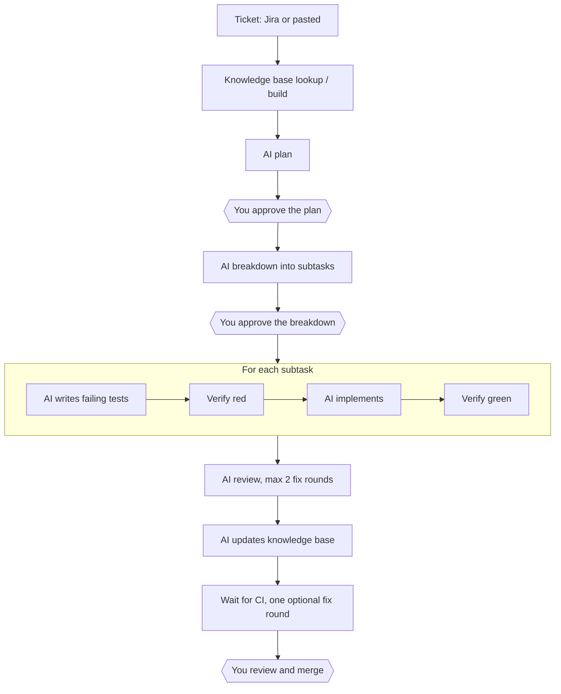

# sdlc-agent

A self-hosted, Docker-based **shipping engine** for solo developers. It turns tickets into reviewable pull requests with AI agents, while keeping AI usage lean and never giving agents access to your machine or credentials.

> **Status: planning / pre-alpha.** The design is complete ([`BUILD_PLAN.md`](./BUILD_PLAN.md)) and broken into sub-tasks ([`SUB_TASKS.md`](./SUB_TASKS.md)), but the application is not built yet. Everything below describes the intended behaviour. Nothing here can be run today.

## Contents

- [What it does](#what-it-does)
- [Why](#why)
- [How it works](#how-it-works)
- [Design principles](#design-principles)
- [Security model](#security-model)
- [Tech stack](#tech-stack)
- [Planned setup](#planned-setup)
- [Configuration](#configuration)
- [Repository layout](#repository-layout)
- [Roadmap](#roadmap)
- [Scope and known limitations](#scope-and-known-limitations)
- [Contributing](#contributing)
- [Security](#security)
- [License](#license)
- [Disclaimer](#disclaimer)

## What it does

sdlc-agent takes a ticket from Jira (or one pasted into its dashboard) and:

1. **Plans** it with AI, then waits for your approval.
2. **Breaks it down** into subtasks, then waits for your approval again.
3. **Implements each subtask test-first**, with AI agents running in isolated containers.
4. **Opens one pull request per ticket**, with one `test:` and one `feat:` commit per subtask.
5. **Reviews** the result automatically for code quality and security, with a capped number of fix rounds.
6. **Hands you** a PR of "junior-engineer quality" to review, adjust and merge.

You stay in control at three points only: plan approval, breakdown approval, and merge.

## Why

Turning tickets into reviewable PRs should take little hand-holding. This project aims to do that while:

- keeping AI usage efficient (one AI stage at a time, capped turns, small prompts, the right model per stage, and a usage gate that pauses the pipeline), and
- never exposing your machine, GitHub credentials or Jira credentials to AI agents.

Anyone can clone the repository and run it with Docker Compose on macOS or a Linux VM.

## How it works



Key points:

- **One branch and one PR per ticket.** A draft PR opens after the first subtask and is marked ready after review and CI.
- **Scripted checks between stages:** dependency install, typecheck, targeted tests, a test-file tamper guard and a commit guard. The full test suite, lint and security scanners stay with your repository's CI.
- **Support queries:** an agent can ask you a question. The ticket goes on hold and the next ticket starts while you answer.
- **Usage gate:** the pipeline pauses at a configurable share of the 5-hour window (default 50%) and the 7-day window (default 80%), with *Resume* and *Ignore usage for this window* actions.
- **Knowledge base:** per-feature docs live in the target repository and are looked up through a deterministic index, then built or updated by AI stages.
- **Dashboard:** single-user password login, live logs, queue, approvals, support queries, settings, guideline editing and minimal charts.
- **Jira integration:** REST polling with a configurable JQL per project (default), or an optional Jira MCP mode for organisations that block API access. Pasting tickets works in every mode. Ticket states can be mapped to Jira statuses.

The full flow, state machine and acceptance criteria are in [`BUILD_PLAN.md`](./BUILD_PLAN.md).

## Design principles

1. **Code does everything that needs no judgment.** Jira calls, git, GitHub, running tests, state tracking and scheduling are plain deterministic code. AI is used only for planning, breakdown, test writing, implementation, fixing, review and knowledge-base writing.
2. **Agents only edit files.** The orchestrator makes every commit, push, PR and Jira call. Agent containers never hold GitHub credentials (and Jira credentials only in the optional Jira MCP mode).
3. **Every AI stage is a fresh, narrow, capped run:** its own container, its own model, its own step limit, and only the context it needs.
4. **Humans gate three points:** plan approval, breakdown approval, and merge.
5. **One AI stage runs at a time**, system-wide, to keep usage predictable.
6. **Everything is configurable per project** (stored in the database), with defaults shipped as files in the repository.

## Security model

- Agent containers run as a non-root user with all capabilities dropped, `no-new-privileges`, memory/CPU/pid limits, a wall-clock timeout and **no Docker socket**.
- Their only network path is an egress proxy (Squid) that allows just the Anthropic API and the npm registry. Their only secret is the Claude token.
- The worker holds the GitHub and Jira credentials. It runs repository code only inside agent containers and commits with git hooks disabled.
- The API is not published to the host, and the dashboard binds to `127.0.0.1` by default.
- Secrets are redacted from logs and from everything shown in the dashboard.
- Ticket text and repository content are treated as untrusted data, never as instructions.
- Agents have no access to merge. There is no auto-merge.
- You are encouraged to enable branch protection on every base branch.

## Tech stack

| Piece | Choice |
| --- | --- |
| Runtime / language | Node.js 24 LTS, TypeScript (strict) |
| Repo layout | npm workspaces + Turborepo |
| API and worker | NestJS (two entrypoints in one codebase) |
| Dashboard | Next.js (App Router) + Tailwind CSS, Recharts |
| Database and queue | PostgreSQL 17 (no Redis), Prisma |
| Validation | Zod |
| Containers | Docker Compose, dockerode, Squid egress proxy |
| Agent | Claude Code CLI, headless (`claude -p`) |
| Git hosting | GitHub (HTTPS), `git` and `gh` CLI |
| Tests | Vitest, Testcontainers, Playwright |

Supported target stacks: TypeScript/Node, NestJS and Next.js.

## Planned setup

> Not available yet. These are the intended steps once the first release exists.

Requirements:

- Docker and Docker Compose, on macOS or a Linux VM
- Access to Claude Code (a token from `claude setup-token`)
- A GitHub repository to ship into, and optionally a Jira Cloud project

```bash
git clone https://github.com/pjx16/sdlc-agentic-workflow.git
cd sdlc-agentic-workflow
cp .env.example .env              # fill in the values described below
docker compose --profile build build
docker compose up -d
```

Then open `http://localhost:3000`, log in with the dashboard password, and add a project (name, HTTPS repository URL, base branch, stack, commands, knowledge-base directory, Jira settings).

## Configuration

Planned environment variables (`.env.example` will list all of them with comments):

| Name | Required | Purpose |
| --- | --- | --- |
| `CLAUDE_CODE_OAUTH_TOKEN` | yes | Output of `claude setup-token` |
| `GITHUB_TOKEN` | yes | Fine-grained token for git and `gh` |
| `GIT_AUTHOR_NAME`, `GIT_AUTHOR_EMAIL` | yes | Identity for every commit |
| `DASHBOARD_PASSWORD`, `SESSION_SECRET` | yes | Single login password and session secret |
| `POSTGRES_PASSWORD` | yes | Database password |
| `DATA_DIR` | yes | Absolute host path for mirrors, workspaces, runs and logs |
| `JIRA_BASE_URL`, `JIRA_EMAIL`, `JIRA_API_TOKEN` | Jira REST mode | Jira Cloud access |
| `JIRA_MCP_CONFIG_FILE`, `JIRA_MCP_CONFIG_PATH`, `JIRA_MCP_HOST`, `JIRA_MCP_AUTH` | Jira MCP mode | Jira MCP server file (host path, and `/config/jira-mcp.json` in the worker), the proxy allowlist host, and the credential the file refers to as `${JIRA_MCP_AUTH}`. Only the two Jira stages receive it. Each MCP read or write is a stage run (about 50-70k tokens), so prefer REST mode where it works. |
| `COOKIE_SECURE`, `DASHBOARD_BIND`, `AGENT_IMAGE`, `AGENT_MEMORY`, `AGENT_CPUS`, `LOG_LEVEL` | no | Optional tuning |

**Token guidance**

- **GitHub:** a fine-grained personal access token limited to the target repositories, with Contents (read/write), Pull requests (read/write), Actions (read), Commit statuses (read) and Metadata (read). Do not grant administration permission.
- **Claude:** run `claude setup-token` on a machine where Claude Code is logged in.
- **Jira:** an API token for the account that should read and update tickets.

Never commit `.env` or any token to the repository.

Per-project settings (stages, models, turn limits, gates, limits, Jira status mapping) are stored in the database and edited in the dashboard. Agent instructions (stage prompts, stack guidelines, review checklist) ship as markdown files in [`guidelines/`](./guidelines) and can be edited from the dashboard.

## Repository layout

Planned layout:

```text
apps/
  api/            NestJS API and worker (Prisma, state machine, agent runner, Git/GitHub/Jira clients)
  dashboard/      Next.js dashboard
packages/
  shared/         Zod schemas, enums and constants
docker/
  agent/          Agent image (Claude Code CLI, run-stage, run-cmd)
  worker/         Worker image (git, gh)
  proxy/          Squid egress proxy
guidelines/       Default CLAUDE.md, stage prompts, stack guidelines, review checklist
test/fake-claude/ Claude CLI stub used by tests
```

## Roadmap

Development follows 14 milestones, defined in [`BUILD_PLAN.md`](./BUILD_PLAN.md) and split into 83 sub-tasks in [`SUB_TASKS.md`](./SUB_TASKS.md):

| # | Milestone |
| --- | --- |
| 0 | Spike: verify Claude Code CLI behaviour, usage events, proxy domains, Jira MCP and `gh` (no application code) |
| 1 | Skeleton: monorepo, Compose, auth, dashboard shell |
| 2 | Projects and settings |
| 3 | Agent runner and egress proxy |
| 4 | Intake, queue and state machine |
| 5 | Knowledge base, plan and plan gate |
| 6 | Breakdown and gate |
| 7 | Subtask TDD loop |
| 8 | Review, KB update and CI |
| 9 | Support queries, hold and retry |
| 10 | Usage gate |
| 11 | Jira MCP mode (skipped if the spike finds it impossible) |
| 12 | Metrics and charts |
| 13 | Hardening, documentation and a live end-to-end run |

Current progress: planning complete, milestone 0 not started.

## Scope and known limitations

Out of scope for v1: a QA agent or post-merge testing, concurrency above 1, Jira webhooks or intake other than Jira and paste, git hosts other than GitHub (HTTPS only, no SSH URLs), multiple users or roles, stacks other than TS/Node, NestJS and Next.js, notifications, auto-merge, and cloud deployment scripts.

Known limitations:

- Targeted tests must be runnable inside a plain Node container with no external services (no database, no network beyond the npm registry).
- The usage gate depends on what the installed Claude Code CLI exposes; milestone 0 decides which source is used.
- Jira MCP mode depends on whether Atlassian's MCP server can authenticate headlessly; milestone 0 decides.

## Contributing

The project is not yet open for code contributions while the foundation is being built, but feedback on the design is welcome.

- Open an issue to discuss ideas, questions or problems with the plan.
- Please read [`BUILD_PLAN.md`](./BUILD_PLAN.md) first. Features outside its scope (§2) will not be accepted into v1.
- Use npm and Turborepo only (no pnpm or yarn). Commits must not carry `Co-Authored-By` trailers or AI attribution.

See [`CONTRIBUTING.md`](./CONTRIBUTING.md) and the [Code of Conduct](./CODE_OF_CONDUCT.md) (both are placeholders for now, to be expanded before the first release).

## Security

Please do **not** report security vulnerabilities in public issues. Use GitHub's private vulnerability reporting (the repository's **Security** tab → **Report a vulnerability**) once it is enabled. See [`SECURITY.md`](./SECURITY.md) (a placeholder for now).

This tool runs AI-generated code and holds a GitHub token. Review the [security model](#security-model), use a fine-grained token limited to the repositories you need, and enable branch protection.

## License

Released under the [MIT License](./LICENSE).

## Disclaimer

This is an independent project. It is not affiliated with, endorsed by or sponsored by Anthropic, Atlassian or GitHub. "Claude" and "Claude Code" are trademarks of Anthropic, "Jira" and "Atlassian" of Atlassian, and "GitHub" of GitHub, Inc. You are responsible for making sure your use of this tool complies with the terms of your Claude Code plan and of every service it connects to.
