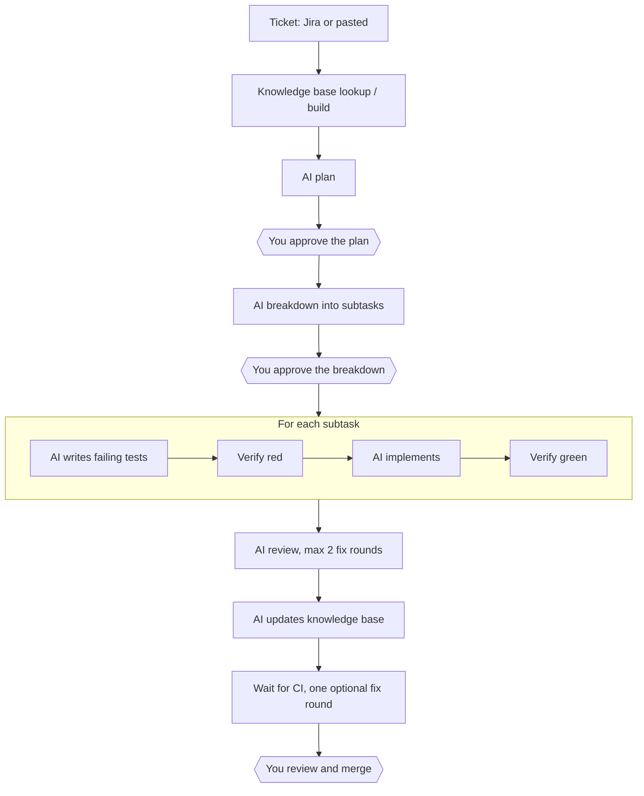

# sdlc-agent

A self-hosted, Docker-based **shipping engine** for solo developers. It turns tickets into reviewable pull requests with AI agents, while keeping AI usage lean and never giving agents access to your machine or credentials.

> **Status: feature-complete, not yet proven on a real ticket.** Every milestone in [`BUILD_PLAN.md`](./BUILD_PLAN.md) is implemented and covered by unit and integration tests (a stand-in for Claude plays the model). The one thing still to do is a full run on a real ticket with live Claude (sub-task 13.5); the result will be recorded under [Live end-to-end run](#live-end-to-end-run). Expect rough edges until then.

## Contents

- [What it does](#what-it-does)
- [Why](#why)
- [How it works](#how-it-works)
- [Design principles](#design-principles)
- [Security model](#security-model)
- [Tech stack](#tech-stack)
- [Setup](#setup)
- [Adding a project](#adding-a-project)
- [Writing guidelines](#writing-guidelines)
- [Configuration](#configuration)
- [Repository layout](#repository-layout)
- [Tests](#tests)
- [Roadmap](#roadmap)
- [Live end-to-end run](#live-end-to-end-run)
- [Scope and known limitations](#scope-and-known-limitations)
- [Contributing](#contributing)
- [Security](#security)
- [License](#license)
- [Disclaimer](#disclaimer)

## What it does

sdlc-agent takes a ticket from Jira (or one pasted into its dashboard) and:

1. **Plans** it with AI, then waits for your approval.
2. **Breaks it down** into subtasks, then waits for your approval again.
3. **Implements each subtask test-first**, with AI agents running in isolated containers.
4. **Opens one pull request per ticket**, with one `test:` and one `feat:` commit per subtask.
5. **Reviews** the result automatically for code quality and security, with a capped number of fix rounds.
6. **Hands you** a PR of "junior-engineer quality" to review, adjust and merge.

You stay in control at three points only: plan approval, breakdown approval, and merge.

## Why

Turning tickets into reviewable PRs should take little hand-holding. This project aims to do that while:

- keeping AI usage efficient (one AI stage at a time, capped turns, small prompts, the right model per stage, and a usage gate that pauses the pipeline), and
- never exposing your machine, GitHub credentials or Jira credentials to AI agents.

Anyone can clone the repository and run it with Docker Compose on macOS or a Linux VM.

## How it works



Key points:

- **One branch and one PR per ticket.** A draft PR opens after the first subtask and is marked ready after review and CI.
- **Scripted checks between stages:** dependency install, typecheck, targeted tests, a test-file tamper guard and a commit guard. The full test suite, lint and security scanners stay with your repository's CI.
- **Support queries:** an agent can ask you a question. The ticket goes on hold and the next ticket starts while you answer.
- **Usage gate:** the pipeline pauses at a configurable share of the 5-hour window (default 50%) and the 7-day window (default 80%), with *Resume* and *Ignore usage for this window* actions.
- **Knowledge base:** per-feature docs live in the target repository and are looked up through a deterministic index, then built or updated by AI stages.
- **Dashboard:** single-user password login, live logs, queue, approvals, support queries, settings, guideline editing and minimal charts.
- **Jira integration:** REST polling with a configurable JQL per project (default), or an optional Jira MCP mode for organisations that block API access. Pasting tickets works in every mode. Ticket states can be mapped to Jira statuses.

The full flow, state machine and acceptance criteria are in [`BUILD_PLAN.md`](./BUILD_PLAN.md).

## Design principles

1. **Code does everything that needs no judgment.** Jira calls, git, GitHub, running tests, state tracking and scheduling are plain deterministic code. AI is used only for planning, breakdown, test writing, implementation, fixing, review and knowledge-base writing.
2. **Agents only edit files.** The orchestrator makes every commit, push, PR and Jira call. Agent containers never hold GitHub credentials (and Jira credentials only in the optional Jira MCP mode).
3. **Every AI stage is a fresh, narrow, capped run:** its own container, its own model, its own step limit, and only the context it needs.
4. **Humans gate three points:** plan approval, breakdown approval, and merge.
5. **One AI stage runs at a time**, system-wide, to keep usage predictable.
6. **Everything is configurable per project** (stored in the database), with defaults shipped as files in the repository.

## Security model

- Agent containers run as a non-root user with all capabilities dropped, `no-new-privileges`, memory/CPU/pid limits, a wall-clock timeout and **no Docker socket**.
- Their only network path is an egress proxy (Squid) that allows just the Anthropic API and the npm registry. Their only secret is the Claude token.
- The worker holds the GitHub and Jira credentials. It runs repository code only inside agent containers and commits with git hooks disabled.
- The API is not published to the host, and the dashboard binds to `127.0.0.1` by default.
- Secrets are redacted from logs and from everything shown in the dashboard.
- Ticket text and repository content are treated as untrusted data, never as instructions.
- Agents have no access to merge. There is no auto-merge.
- You are encouraged to enable branch protection on every base branch.

## Tech stack

| Piece | Choice |
| --- | --- |
| Runtime / language | Node.js 24 LTS, TypeScript (strict) |
| Repo layout | npm workspaces + Turborepo |
| API and worker | NestJS (two entrypoints in one codebase) |
| Dashboard | Next.js (App Router) + Tailwind CSS, Recharts |
| Database and queue | PostgreSQL 17 (no Redis), Prisma |
| Validation | Zod |
| Containers | Docker Compose, dockerode, Squid egress proxy |
| Agent | Claude Code CLI, headless (`claude -p`) |
| Git hosting | GitHub (HTTPS), `git` and `gh` CLI |
| Tests | Vitest, Testcontainers, Playwright |

Supported target stacks: TypeScript/Node, NestJS and Next.js.

## Setup

Requirements:

- Docker and Docker Compose, on macOS or a Linux VM (the host user must be able to use the Docker socket)
- Access to Claude Code: a token from `claude setup-token`
- A GitHub repository to ship into, and optionally a Jira Cloud project

```bash
git clone https://github.com/pjx16/sdlc-agentic-workflow.git
cd sdlc-agentic-workflow
cp .env.example .env              # fill in the values described under Configuration
mkdir -p "$(grep ^DATA_DIR= .env | cut -d= -f2)"
docker compose --profile build build   # builds the agent image (sdlc-agent/agent:latest)
docker compose up -d
```

Then open `http://localhost:3000`, log in with `DASHBOARD_PASSWORD`, and add a project. `DATA_DIR` must be an absolute path that exists on the host; mirrors, workspaces, run folders and logs live there. Check that everything is up with `docker compose ps`; the API reports `healthy` at `/health` inside the Compose network.

To stop: `docker compose down`. The database lives in a Docker volume and survives restarts.

## Adding a project

Open **Projects → New** and enter:

- **Name**, **repository URL** (HTTPS, for example `https://github.com/acme/billing`) and **base branch** (default `dev`).
- **Stack** (TypeScript/Node, NestJS or Next.js). Choosing it pre-fills the install, typecheck and targeted-test commands; all are editable. The test command must contain `{files}`.
- **Knowledge-base directory**, relative to the repository root (default `docs/kb`).
- **CLAUDE.md mode**: `ours` (our defaults, the repository's own `CLAUDE.md` is hidden from Claude), `theirs` (only the repository's), or `both`.
- **Jira** mode (REST, MCP or off), Jira project key and JQL.

Save. The worker clones a bare mirror in the background and checks that the base branch exists. The project shows *Cloning*, then *Ready*, or *Failed* with the error (fix the URL or token and press Retry). A project accepts tickets only when it is *Ready*.

A **suggested JQL** for REST mode, so each ticket is picked up once and only when you mean it:

```text
project = ABC AND issuetype in (Story, Bug, Task) AND status = "Ready for Dev" ORDER BY created ASC
```

Use a status or a label that only you set (for example `labels = sdlc-agent`). Anything the JQL returns is stored as a ticket, once per issue. Pasting a ticket in the dashboard works in every Jira mode.

Optional per-project settings: which stages run, models and turn limits, the plan and breakdown gates, review rounds and other limits, CI behaviour, and the mapping from pipeline states to Jira statuses (and which Jira status counts as approval).

## Writing guidelines

What the agents are told lives in [`guidelines/`](./guidelines) as markdown, and is editable on the dashboard's **Guidelines** page:

- `stages/*.md`: the instructions for each stage (what to do, constraints, the shape of the answer).
- `stacks/*.md`: conventions for each supported stack, added to every stage's system prompt.
- `default-CLAUDE.md`: our default `CLAUDE.md`, used in modes `ours` and `both`.
- `review-checklist.md` and `kb-doc-template.md`: what the review checks, and the shape of a knowledge-base doc.

Keep instructions short and concrete: every line is paid for in tokens on every run. Changes apply from the next stage run. The repository's own `CLAUDE.md` is the right place for rules that belong to that codebase.

## Configuration

Environment variables (`.env.example` lists all of them with comments):

| Name | Required | Purpose |
| --- | --- | --- |
| `CLAUDE_CODE_OAUTH_TOKEN` | yes | Output of `claude setup-token` |
| `GITHUB_TOKEN` | yes | Fine-grained token for git and `gh` |
| `GIT_AUTHOR_NAME`, `GIT_AUTHOR_EMAIL` | yes | Identity for every commit |
| `DASHBOARD_PASSWORD`, `SESSION_SECRET` | yes | Single login password and session secret |
| `POSTGRES_PASSWORD` | yes | Database password |
| `DATA_DIR` | yes | Absolute host path for mirrors, workspaces, runs and logs |
| `JIRA_BASE_URL`, `JIRA_EMAIL`, `JIRA_API_TOKEN` | Jira REST mode | Jira Cloud access |
| `JIRA_MCP_CONFIG_FILE`, `JIRA_MCP_CONFIG_PATH`, `JIRA_MCP_HOST`, `JIRA_MCP_AUTH` | Jira MCP mode | Jira MCP server file (host path, and `/config/jira-mcp.json` in the worker), the proxy allowlist host, and the credential the file refers to as `${JIRA_MCP_AUTH}`. Only the two Jira stages receive it. Each MCP read or write is a stage run (about 50-70k tokens), so prefer REST mode where it works. |
| `COOKIE_SECURE` | no | `true` when the dashboard is served over HTTPS (marks the session cookie `Secure`) |
| `DASHBOARD_BIND` | no | Address the dashboard port binds to (default `127.0.0.1`) |
| `AGENT_IMAGE`, `AGENT_MEMORY`, `AGENT_CPUS` | no | Agent image, and the memory and CPU limit of each agent container |
| `LOG_LEVEL` | no | Log level of the API and worker (default `info`) |

**Token guidance**

- **GitHub:** a fine-grained personal access token limited to the target repositories, with Contents (read/write), Pull requests (read/write), Actions (read), Commit statuses (read) and Metadata (read). Do not grant administration permission.
- **Claude:** run `claude setup-token` on a machine where Claude Code is logged in.
- **Jira:** an API token for the account that should read and update tickets.

Never commit `.env` or any token to the repository.

Per-project settings (stages, models, turn limits, gates, limits, Jira status mapping) are stored in the database and edited in the dashboard. Agent instructions (stage prompts, stack guidelines, review checklist) ship as markdown files in [`guidelines/`](./guidelines) and can be edited from the dashboard.

## Repository layout

```text
apps/
  api/            NestJS API and worker (Prisma, state machine, agent runner, Git/GitHub/Jira clients)
  dashboard/      Next.js dashboard
packages/
  shared/         Zod schemas, enums and constants
docker/
  agent/          Agent image (Claude Code CLI, run-stage, run-cmd)
  worker/         Worker image (git, gh)
  proxy/          Squid egress proxy
guidelines/       Default CLAUDE.md, stage prompts, stack guidelines, review checklist
test/fake-claude/ Claude CLI stub used by tests
```

## Tests

```bash
npm test           # unit tests, no Docker needed
npm run test:int   # integration tests: Postgres through Testcontainers, real git, real Docker for the agent container tests
npm run test:e2e   # Playwright: a seeded Postgres, the built API and the dashboard, a real browser (first run: npx playwright install chromium)
npm run test:live  # needs LIVE_CLAUDE=1 and a real token: runs one stage against the real Claude Code CLI
```

The end-to-end suite starts its own Postgres container and the API and dashboard processes (it does not use the Compose stack, because the pages are checked against seeded states and the Compose stack would need a reachable GitHub repository). It logs in, creates a project, pastes a ticket, approves a plan and a breakdown, answers a support query, uses *Ignore usage* and *Resume*, opens every page, and checks every chart with data and without.

`test/fake-claude/` is a stand-in for the Claude CLI that plays scripted answers, so the whole pipeline can be tested without spending any usage.

## Roadmap

Development followed 14 milestones, defined in [`BUILD_PLAN.md`](./BUILD_PLAN.md) and split into sub-tasks in [`SUB_TASKS.md`](./SUB_TASKS.md):

| # | Milestone | State |
| --- | --- | --- |
| 0 | Spike: Claude Code CLI behaviour, usage events, proxy domains, Jira MCP and `gh` | done ([`SPIKE.md`](./SPIKE.md)) |
| 1 | Skeleton: monorepo, Compose, auth, dashboard shell | done |
| 2 | Projects and settings | done |
| 3 | Agent runner and egress proxy | done |
| 4 | Intake, queue and state machine | done |
| 5 | Knowledge base, plan and plan gate | done |
| 6 | Breakdown and gate | done |
| 7 | Subtask TDD loop | done |
| 8 | Review, KB update and CI | done |
| 9 | Support queries, hold and retry | done |
| 10 | Usage gate | done |
| 11 | Jira MCP mode | done (tested against a stand-in, not a live MCP server) |
| 12 | Metrics and charts | done |
| 13 | Hardening, documentation and a live end-to-end run | hardening and docs done; live run pending |

## Live end-to-end run

Not done yet. Sub-task 13.5 is one full run on a small real ticket with live Claude; its result (ticket, models, tokens used, PR, what went wrong) will be recorded here.

## Scope and known limitations

Out of scope for v1: a QA agent or post-merge testing, concurrency above 1, Jira webhooks or intake other than Jira and paste, git hosts other than GitHub (HTTPS only, no SSH URLs), multiple users or roles, stacks other than TS/Node, NestJS and Next.js, notifications, auto-merge, and cloud deployment scripts.

Known limitations:

- Targeted tests must be runnable inside a plain Node container with no external services (no database, no network beyond the npm registry).
- The usage gate reads the `rate_limit_event` that Claude Code prints (SPIKE.md 0.2). If a future CLI stops printing it, the gate falls back to an estimate from tokens, which needs `calibratedWindowTokens` to be set on the Usage page.
- Jira MCP mode works headlessly with a scoped Atlassian API token (SPIKE.md 0.7), but the organisation must allow API-token access to the Rovo MCP server. It has only been tested against a stand-in, and every MCP read or write is a stage run (about 50-70k tokens), so use REST mode where it works.
- Only one stage runs at a time, system-wide, and a ticket's whole run is sequential.
- The first-pass rate on the Overview is approximate: a subtask has no completion time of its own, so it counts in the range where its last stage run ended.
- Untested against a real GitHub repository and real Claude until sub-task 13.5 is done.

## Contributing

Feedback on the design is welcome, and code contributions can be discussed in an issue first.

- Open an issue to discuss ideas, questions or problems with the plan.
- Please read [`BUILD_PLAN.md`](./BUILD_PLAN.md) first. Features outside its scope (§2) will not be accepted into v1.
- Use npm and Turborepo only (no pnpm or yarn). Commits must not carry `Co-Authored-By` trailers or AI attribution.

See [`CONTRIBUTING.md`](./CONTRIBUTING.md) and the [Code of Conduct](./CODE_OF_CONDUCT.md) (both are placeholders for now, to be expanded before the first release).

## Security

Please do **not** report security vulnerabilities in public issues. Use GitHub's private vulnerability reporting (the repository's **Security** tab → **Report a vulnerability**) once it is enabled. See [`SECURITY.md`](./SECURITY.md) (a placeholder for now).

This tool runs AI-generated code and holds a GitHub token. Review the [security model](#security-model), use a fine-grained token limited to the repositories you need, and enable branch protection.

## License

Released under the [MIT License](./LICENSE).

## Disclaimer

This is an independent project. It is not affiliated with, endorsed by or sponsored by Anthropic, Atlassian or GitHub. "Claude" and "Claude Code" are trademarks of Anthropic, "Jira" and "Atlassian" of Atlassian, and "GitHub" of GitHub, Inc. You are responsible for making sure your use of this tool complies with the terms of your Claude Code plan and of every service it connects to.
