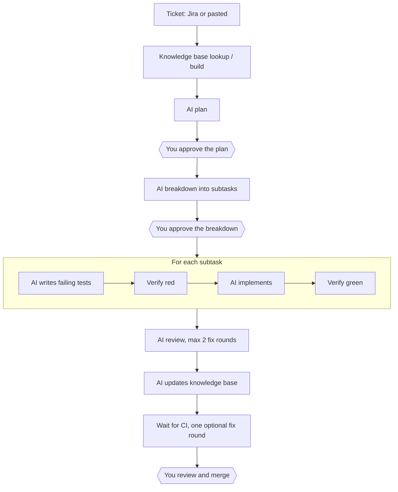

# sdlc-agent

[](https://github.com/pjx16/sdlc-agentic-workflow/actions/workflows/ci.yml)
[](https://github.com/pjx16/sdlc-agentic-workflow/releases)
[](./LICENSE)

A self-hosted, Docker-based **shipping engine** for solo developers. It turns tickets into reviewable pull requests with AI agents, while keeping AI usage lean and never giving agents access to your machine or credentials.

> [!WARNING]
> **Status: under development.** This is a `0.0.0` pre-release. It is published so I can use it on my own projects and find what breaks. It is not production-ready, and it is not supported for anyone else.
>
> **Known limits**
> - Only TypeScript/JavaScript stacks (Node.js, NestJS, Next.js) for now.
> - Single user, password login.
> - Agents run with full permissions inside their Docker containers. Don't point it at repositories you can't afford to lose, and don't run it on a machine that holds credentials you don't want exposed.
> - The Claude usage pause is a guard, not a guarantee. Check your plan's limits yourself.
>
> Feedback and bug reports are welcome, but expect breaking changes until `0.1.0`.

**What has been tested.** The milestones in [`BUILD_PLAN.md`](./BUILD_PLAN.md) are implemented and covered by unit, integration and browser tests (a stand-in plays Claude in those). One small real ticket has run end to end with live Claude, from a pasted ticket to a merged PR (see [Live end-to-end run](#live-end-to-end-run)). Larger tickets, review findings, CI failures and Jira have not been exercised live.

## What it does

sdlc-agent takes a ticket from Jira (or one pasted into its dashboard) and:

1. **Plans** it with AI, then waits for your approval.
2. **Breaks it down** into subtasks, then waits for your approval again.
3. **Implements each subtask test-first**, with AI agents running in isolated containers.
4. **Opens one pull request per ticket**, with one `test:` and one `feat:` commit per subtask.
5. **Reviews** the result automatically for code quality and security, with a capped number of fix rounds.
6. **Hands you** a PR of "junior-engineer quality" to review, adjust and merge.

You stay in control at three points only: plan approval, breakdown approval, and merge.

## Why

Turning tickets into reviewable PRs should take little hand-holding. This project aims to do that while:

- keeping AI usage efficient (one AI stage at a time, capped turns, small prompts, the right model per stage, and a usage gate that pauses the pipeline), and
- never exposing your machine, GitHub credentials or Jira credentials to AI agents.

Anyone can clone the repository and run it with Docker Compose on macOS or a Linux VM.

## How it works



Key points:

- **One branch and one PR per ticket.** A draft PR opens after the first subtask and is marked ready after review and CI.
- **Scripted checks between stages:** dependency install, typecheck, targeted tests, a test-file tamper guard and a commit guard. The full test suite, lint and security scanners stay with your repository's CI.
- **Support queries:** an agent can ask you a question. The ticket goes on hold and the next ticket starts while you answer.
- **Usage gate:** the pipeline pauses at a configurable share of the 5-hour window (default 50%) and the 7-day window (default 80%), with *Resume* and *Ignore usage for this window* actions.
- **Knowledge base:** per-feature docs live in the target repository and are looked up through a deterministic index, then built or updated by AI stages.
- **Dashboard:** single-user password login, live logs, queue, approvals, support queries, settings, guideline editing and minimal charts.
- **Jira integration:** REST polling with a configurable JQL per project (default), or an optional Jira MCP mode for organisations that block API access. Pasting tickets works in every mode. Ticket states can be mapped to Jira statuses.

The full flow, state machine and acceptance criteria are in [`BUILD_PLAN.md`](./BUILD_PLAN.md). For how the pieces fit together (services, trust boundaries, ticket lifecycle, worker loop, data model) and how that has changed over time, see [`docs/architecture`](./docs/architecture/README.md).

## Design principles

1. **Code does everything that needs no judgment.** Jira calls, git, GitHub, running tests, state tracking and scheduling are plain deterministic code. AI is used only for planning, breakdown, test writing, implementation, fixing, review and knowledge-base writing.
2. **Agents only edit files.** The orchestrator makes every commit, push, PR and Jira call. Agent containers never hold GitHub credentials (and Jira credentials only in the optional Jira MCP mode).
3. **Every AI stage is a fresh, narrow, capped run:** its own container, its own model, its own step limit, and only the context it needs.
4. **Humans gate three points:** plan approval, breakdown approval, and merge.
5. **One AI stage runs at a time**, system-wide, to keep usage predictable.
6. **Everything is configurable per project** (stored in the database), with defaults shipped as files in the repository.

## Security model

- Agent containers run as a non-root user with all capabilities dropped, `no-new-privileges`, memory/CPU/pid limits, a wall-clock timeout and **no Docker socket**.
- The workspace's `.git` directory is mounted **read-only** in every agent container, so an agent can edit files but cannot change git config, hooks or refs.
- Their only network path is an egress proxy (Squid) that allows just HTTPS tunnels to the Anthropic API and the npm registry. Their only secret is the Claude token.
- The worker holds the GitHub and Jira credentials. It runs repository code only inside agent containers, and runs git with hooks, fsmonitor, credential helpers and non-HTTPS protocols disabled. It pushes to the repository URL stored for the project, never to the workspace's `origin`.
- Repositories are restricted to `https://github.com/...`, and the GitHub token is only ever handed to github.com.
- The worker never follows symlinks when it reads or writes files in an agent-written workspace.
- The API is not published to the host, and the dashboard binds to `127.0.0.1` by default. The API refuses cross-site state-changing requests, and the dashboard sends anti-framing and `nosniff` headers.
- Tokens entered in the dashboard are stored in your local Postgres, encrypted with `ENCRYPTION_KEY`; anyone who can read both `.env` and the database can read them. Back up `.env` separately from the database. Losing `ENCRYPTION_KEY` means re-entering the tokens.
- Secrets are redacted from logs (including the session cookie) and from everything shown in the dashboard.
- Ticket text and repository content are treated as untrusted data, never as instructions.
- Agents have no access to merge. There is no auto-merge.
- You are encouraged to enable branch protection on every base branch.

**Residual risks**

- The worker runs as root with the Docker socket, which is equivalent to root on the host. Run it on a dedicated VM or machine.
- Agents can reach the Anthropic API and the npm registry, and a prompt-injected agent could use them to send repository content out. Only use repositories whose content you are comfortable sending to those services.
- The npm cache volume is shared between projects.
- Never publish the dashboard beyond `127.0.0.1` without a TLS reverse proxy and `COOKIE_SECURE=true`.

## Tech stack

| Piece | Choice |
| --- | --- |
| Runtime / language | Node.js 24 LTS, TypeScript (strict) |
| Repo layout | npm workspaces + Turborepo |
| API and worker | NestJS (two entrypoints in one codebase) |
| Dashboard | Next.js (App Router) + Tailwind CSS, Recharts |
| Database and queue | PostgreSQL 17 (no Redis), Prisma |
| Validation | Zod |
| Containers | Docker Compose, dockerode, Squid egress proxy |
| Agent | Claude Code CLI, headless (`claude -p`) |
| Git hosting | GitHub (HTTPS), `git` and `gh` CLI |
| Tests | Vitest, Testcontainers, Playwright |

Supported target stacks: TypeScript/Node, NestJS and Next.js.

## Architecture


The architecture is documented per version in [`docs/architecture`](./docs/architecture/README.md); the current one is the [architecture docs (1.0.0)](./docs/architecture/v1.0.0/README.md), with diagrams that GitHub renders: the system and its containers, trust boundaries (which secret lives where), the ticket lifecycle, the subtask loop, the worker loop, stages and models, and the data model. It ends with a change log. The folder also holds the architecture change log. **If you change the structure, add a new version folder in the same pull request** (the rules are in the index).

## Setup

Requirements:

- Docker and Docker Compose, on macOS or a Linux VM (the host user must be able to use the Docker socket)
- Access to Claude Code: a token from `claude setup-token`
- A GitHub repository to ship into, and optionally a Jira Cloud project

### Install with the CLI

```bash
npx sdlc-agent init
```

`init` checks Docker, creates `~/.sdlc-agent` with generated secrets, starts the stack from the published images and opens the dashboard, where you enter the setup code it printed, create the admin password and add your tokens. Later: `sdlc-agent upgrade`, `down`, `up`, `logs`, `doctor`. See [`packages/cli`](./packages/cli/README.md).

### Install a release (tarball)

Releases are published on [GitHub Releases](https://github.com/pjx16/sdlc-agentic-workflow/releases). Nothing is built on your machine: the images come from GHCR.

```bash
# Download sdlc-agent-<version>.tar.gz and SHA256SUMS from the release page, then:
shasum -a 256 -c SHA256SUMS            # macOS; on Linux: sha256sum -c SHA256SUMS
tar -xzf sdlc-agent-<version>.tar.gz
cd sdlc-agent-<version>
cp .env.example .env                   # set POSTGRES_PASSWORD, ENCRYPTION_KEY (openssl rand -base64 32) and DATA_DIR; SDLC_VERSION is already set
mkdir -p "$(grep ^DATA_DIR= .env | cut -d= -f2)"
docker compose up -d
```

The worker pulls the agent image on its first start, so the first run takes a little longer. Then open `http://localhost:3000`, enter the setup code from `docker compose logs api | grep 'setup code'`, create the admin password, and add your tokens in the setup wizard. Then add a project.

The images are published to GHCR with provenance attestations. To verify one (needs the GitHub CLI):

```bash
gh attestation verify oci://ghcr.io/pjx16/sdlc-agent-api:<version> --owner pjx16
```

### Run from source

```bash
git clone https://github.com/pjx16/sdlc-agentic-workflow.git
cd sdlc-agentic-workflow
cp .env.example .env              # set POSTGRES_PASSWORD, ENCRYPTION_KEY (openssl rand -base64 32) and DATA_DIR; tokens are entered in the dashboard
mkdir -p "$(grep ^DATA_DIR= .env | cut -d= -f2)"
docker compose --profile build build   # builds the agent image (sdlc-agent/agent:latest)
docker compose up -d
```

Then open `http://localhost:3000`, enter the setup code from `docker compose logs api | grep 'setup code'`, then add your tokens, and add a project. `DATA_DIR` must be an absolute path that exists on the host; mirrors, workspaces, run folders and logs live there. Check that everything is up with `docker compose ps`; the API reports `healthy` at `/health` inside the Compose network.

One-line shortcuts, from the repository root:

```bash
npm run up:prod   # production mode: builds the images and starts everything in Docker, waits until healthy
npm run up:dev    # development mode: Postgres and the proxy in Docker; API, worker and dashboard on your machine with hot reload (Ctrl+C stops them)
npm run down      # stops the Docker containers
```

Development mode needs the GitHub CLI (`gh`) installed, because the worker runs outside Docker there.

To stop: `docker compose down`. The database lives in a Docker volume and survives restarts.

## Use it as a desktop app

The dashboard can be installed as an app that opens in its own window, with its own icon and no browser tabs. The stack itself still runs in Docker.

- **Chrome or Edge:** click the install icon in the address bar, or the **Install app** button at the bottom of the sidebar.
- **Safari on macOS:** **File → Add to Dock**.
- It only works on `localhost` or `127.0.0.1` (or behind HTTPS), because browsers only offer installation on a secure context. Each address is a separate installed app.
- The stack must be running (`sdlc-agent up` or `docker compose up -d`) for the app window to show anything.
- Firefox cannot install it.

## Adding a project

Open **Projects → New** and enter:

- **Name**, **repository URL** (an HTTPS `github.com` URL, for example `https://github.com/acme/billing`) and **base branch** (default `dev`).
- **Stack** (TypeScript/Node, NestJS or Next.js). Choosing it pre-fills the install, typecheck and targeted-test commands; all are editable. The test command must contain `{files}`.
- **Knowledge-base directory**, relative to the repository root (default `docs/kb`).
- **CLAUDE.md mode**: `ours` (our defaults, the repository's own `CLAUDE.md` is hidden from Claude), `theirs` (only the repository's), or `both`.
- **Jira** mode (REST, MCP or off), Jira project key and JQL.

Save. The worker clones a bare mirror in the background and checks that the base branch exists. The project shows *Cloning*, then *Ready*, or *Failed* with the error (fix the URL or token and press Retry). A project accepts tickets only when it is *Ready*.

A **suggested JQL** for REST mode, so each ticket is picked up once and only when you mean it:

```text
project = ABC AND issuetype in (Story, Bug, Task) AND status = "Ready for Dev" ORDER BY created ASC
```

Use a status or a label that only you set (for example `labels = sdlc-agent`). Anything the JQL returns is stored as a ticket, once per issue. Pasting a ticket in the dashboard works in every Jira mode.

Optional per-project settings: which stages run, models and turn limits, the plan and breakdown gates, review rounds and other limits, CI behaviour, and the mapping from pipeline states to Jira statuses (and which Jira status counts as approval).

## Writing guidelines

What the agents are told lives in [`guidelines/`](./guidelines) as markdown, and is editable on the dashboard's **Guidelines** page:

- `stages/*.md`: the instructions for each stage (what to do, constraints, the shape of the answer).
- `stacks/*.md`: conventions for each supported stack, added to every stage's system prompt.
- `default-CLAUDE.md`: our default `CLAUDE.md`, used in modes `ours` and `both`.
- `review-checklist.md` and `kb-doc-template.md`: what the review checks, and the shape of a knowledge-base doc.

Keep instructions short and concrete: every line is paid for in tokens on every run. Changes apply from the next stage run. The repository's own `CLAUDE.md` is the right place for rules that belong to that codebase.

## Configuration

Environment variables (`.env.example` lists all of them with comments):

| Name | Required | Purpose |
| --- | --- | --- |
| `ENCRYPTION_KEY` | yes | 32 random bytes, base64 (`openssl rand -base64 32`). Encrypts the tokens saved in the dashboard. |
| `CLAUDE_CODE_OAUTH_TOKEN` | no | Output of `claude setup-token`. Normally entered in the dashboard; a value here overrides it and makes it read-only there |
| `GITHUB_TOKEN` | no | Fine-grained token for git and `gh`. Same rule as above |
| `GIT_AUTHOR_NAME`, `GIT_AUTHOR_EMAIL` | no | Identity for every commit. Same rule as above |
| `DASHBOARD_PASSWORD` | no | Login password (at least 12 characters). Normally created in the setup wizard; a value here overrides it |
| `SETUP_CODE` | no | One-time code for the setup wizard (otherwise the API logs one at start-up) |
| `POSTGRES_PASSWORD` | yes | Database password |
| `DATA_DIR` | yes | Absolute host path for mirrors, workspaces, runs and logs |
| `JIRA_BASE_URL`, `JIRA_EMAIL`, `JIRA_API_TOKEN` | Jira REST mode | Jira Cloud access |
| `JIRA_MCP_CONFIG_FILE`, `JIRA_MCP_CONFIG_PATH`, `JIRA_MCP_HOST`, `JIRA_MCP_AUTH` | Jira MCP mode | Jira MCP server file (host path, and `/config/jira-mcp.json` in the worker), the proxy allowlist host, and the credential the file refers to as `${JIRA_MCP_AUTH}`. Only the two Jira stages receive it. Each MCP read or write is a stage run (about 50-70k tokens), so prefer REST mode where it works. |
| `COOKIE_SECURE` | no | `true` when the dashboard is served over HTTPS (marks the session cookie `Secure`) |
| `DASHBOARD_BIND` | no | Address the dashboard port binds to (default `127.0.0.1`) |
| `AGENT_IMAGE`, `AGENT_MEMORY`, `AGENT_CPUS` | no | Agent image, and the memory and CPU limit of each agent container |
| `LOG_LEVEL` | no | Log level of the API and worker (default `info`) |

**Token guidance**

- **GitHub:** a fine-grained personal access token limited to the target repositories, with Contents (read/write), Pull requests (read/write), Actions (read), Commit statuses (read) and Metadata (read). Do not grant administration permission.
- **Claude:** run `claude setup-token` on a machine where Claude Code is logged in.
- **Jira:** an API token for the account that should read and update tickets.

Never commit `.env` or any token to the repository.

Per-project settings (stages, models, turn limits, gates, limits, Jira status mapping) are stored in the database and edited in the dashboard. Agent instructions (stage prompts, stack guidelines, review checklist) ship as markdown files in [`guidelines/`](./guidelines) and can be edited from the dashboard.

## Repository layout

```text
apps/
  api/            NestJS API and worker (Prisma, state machine, agent runner, Git/GitHub/Jira clients)
  dashboard/      Next.js dashboard
  e2e/            Playwright browser tests (own Postgres, built API, dashboard)
packages/
  shared/         Zod schemas, enums and constants
docker/
  agent/          Agent image (Claude Code CLI, run-stage, run-cmd)
  worker/         Worker image (git, gh)
  proxy/          Squid egress proxy
docs/architecture/ Architecture per version (v1.0.0/), diagrams and change log
guidelines/       Default CLAUDE.md, stage prompts, stack guidelines, review checklist
test/fake-claude/ Claude CLI stub used by tests
```

## Tests

```bash
npm test           # unit tests, no Docker needed
npm run test:int   # integration tests: Postgres through Testcontainers, real git, real Docker for the agent container tests
npm run test:e2e   # Playwright: a seeded Postgres, the built API and the dashboard, a real browser (first run: npx playwright install chromium)
npm run test:live  # needs LIVE_CLAUDE=1 and a real token: runs one stage against the real Claude Code CLI
```

The end-to-end suite starts its own Postgres container and the API and dashboard processes (it does not use the Compose stack, because the pages are checked against seeded states and the Compose stack would need a reachable GitHub repository). It logs in, creates a project, pastes a ticket, approves a plan and a breakdown, answers a support query, uses *Ignore usage* and *Resume*, opens every page, and checks every chart with data and without.

`test/fake-claude/` is a stand-in for the Claude CLI that plays scripted answers, so the whole pipeline can be tested without spending any usage.

## Roadmap

The first build was split into 14 milestones, defined in [`BUILD_PLAN.md`](./BUILD_PLAN.md) and split into sub-tasks in [`SUB_TASKS.md`](./SUB_TASKS.md):

| # | Milestone | State |
| --- | --- | --- |
| 0 | Spike: Claude Code CLI behaviour, usage events, proxy domains, Jira MCP and `gh` | done ([`SPIKE.md`](./SPIKE.md)) |
| 1 | Skeleton: monorepo, Compose, auth, dashboard shell | done |
| 2 | Projects and settings | done |
| 3 | Agent runner and egress proxy | done |
| 4 | Intake, queue and state machine | done |
| 5 | Knowledge base, plan and plan gate | done |
| 6 | Breakdown and gate | done |
| 7 | Subtask TDD loop | done |
| 8 | Review, KB update and CI | done |
| 9 | Support queries, hold and retry | done |
| 10 | Usage gate | done |
| 11 | Jira MCP mode | done (tested against a stand-in, not a live MCP server) |
| 12 | Metrics and charts | done |
| 13 | Hardening, documentation and a live end-to-end run | done (one small live run, see below) |

## Live end-to-end run

Run on 2026-11-12 with live Claude, Docker Compose, and a private scratch repository (TypeScript, one `add` function with a Vitest test) on branch `dev`. The ticket was pasted into the dashboard:

> **LIVE-1 – Add a multiply function.** Add `multiply(a, b)` to `src/math.ts`, with tests covering positive numbers, zero and negatives.

Result: **it reached `DONE`**. The pipeline went NEW → PLANNING → plan approved → BREAKDOWN (1 subtask) → breakdown approved → IN_PROGRESS → REVIEW → KB_UPDATE → AWAITING_CI → IN_HUMAN_REVIEW. The ticket moved to `DONE` about a minute after the PR was squash-merged on GitHub. The PR had four commits (`docs` KB build, `test:`, `feat:`, `docs` KB update), ready for review, with a review summary comment. The review stage found nothing to fix in its one round. The scratch repository has no CI, so "checks passed" was immediate.

Tokens (all stages, 24 h window): about **184,000** in total. kbBuild 20k, plan 20k, breakdown 23k, tests 54k (three rounds, see below), implement 22k, review 21k, kbUpdate 23k. Models were the defaults (Opus for the plan, Sonnet for the rest, Haiku for the breakdown).

What went wrong (the first two are fixed, the last two remain):

- **npm cache volume was root-owned**, so every dependency install in an agent container failed (`EACCES` on `/npm-cache`). The agent Dockerfile now creates `/npm-cache` owned by `node`. An *existing* volume needs a one-off `chown`.
- **The worker refused the workspace** ("dubious ownership"): workspaces are written by the agent user (uid 1000), the worker is root. The worker image now sets `safe.directory '*'`, and every worker git call also passes `core.fsmonitor=false` (hooks were already disabled), so a workspace's own git config cannot run code in the worker.
- **A failed first install left a half-installed `node_modules`**, and a retry skips the install when `node_modules` exists, so the tests stage held twice ("Cannot find module"). I reinstalled by hand and pressed Retry. Not fixed: a failed install should remove `node_modules`. Until then, delete the workspace's `node_modules` *and* reinstall, or delete the workspace.
- A held ticket's **Retry restarts only the subtask loop**; it does not redo the workspace install.

A second run on a two-function ticket (`slugify` and `truncate`) produced a ready PR with six commits, 17 passing tests and a clean typecheck. It also showed two problems that are now fixed: the ticket text was sent under the wrong field name and silently dropped (the API now rejects unknown fields), and the knowledge-base doc kept "does not exist yet" notes (the `kbUpdate` stage now rewrites them).

Not exercised in these runs: a review that finds issues, CI failures, support queries, Jira (REST or MCP), the usage gate pausing a run, and a multi-subtask ticket.

## Scope and known limitations

Out of scope for now: a QA agent or post-merge testing, concurrency above 1, Jira webhooks or intake other than Jira and paste, git hosts other than GitHub (HTTPS only, no SSH URLs), multiple users or roles, stacks other than TS/Node, NestJS and Next.js, notifications, auto-merge, and cloud deployment scripts.

Known limitations:

- Targeted tests must be runnable inside a plain Node container with no external services (no database, no network beyond the npm registry).
- The usage gate reads the `rate_limit_event` that Claude Code prints (SPIKE.md 0.2). If a future CLI stops printing it, the gate falls back to an estimate from tokens, which needs `calibratedWindowTokens` to be set on the Usage page.
- Jira MCP mode works headlessly with a scoped Atlassian API token (SPIKE.md 0.7), but the organisation must allow API-token access to the Rovo MCP server. It has only been tested against a stand-in, and every MCP read or write is a stage run (about 50-70k tokens), so use REST mode where it works.
- Only one stage runs at a time, system-wide, and a ticket's whole run is sequential.
- The first-pass rate on the Overview is approximate: a subtask has no completion time of its own, so it counts in the range where its last stage run ended.
- Only one small ticket (one subtask, then two) has run with live Claude. Review fixes, CI fixes, support queries, Jira and larger tickets have only been tested against the stand-in.
- A failed first dependency install leaves a half-installed `node_modules`, and Retry skips the reinstall. Delete the workspace's `node_modules` and reinstall, or delete the workspace (see the live run notes).
- Creating a ticket through the API requires the text in `body`; unknown fields are rejected.

## Releases and versioning

Versions follow [semantic versioning](https://semver.org/). `0.0.x` releases are pre-releases for the author's own use, and breaking changes (database migrations, configuration, API) are allowed until `0.1.0`. See [`CHANGELOG.md`](./CHANGELOG.md) before upgrading.

## Contributing

Bug reports and feedback are welcome through issues. Pull requests are not accepted yet, except small fixes agreed in an issue first. See [`CONTRIBUTING.md`](./CONTRIBUTING.md) for the ground rules, and [`SECURITY.md`](./SECURITY.md) for how to report a vulnerability.

## Security

Please do **not** report security vulnerabilities in public issues. Use GitHub's private vulnerability reporting (the repository's **Security** tab → **Report a vulnerability**). See [`SECURITY.md`](./SECURITY.md) for the threat model and the known residual risks.

This tool runs AI-generated code and holds a GitHub token. Review the [security model](#security-model), use a fine-grained token limited to the repositories you need, and enable branch protection.

## License

Released under the [MIT License](./LICENSE).

## Disclaimer

This is an independent project. It is not affiliated with, endorsed by or sponsored by Anthropic, Atlassian or GitHub. "Claude" and "Claude Code" are trademarks of Anthropic, "Jira" and "Atlassian" of Atlassian, and "GitHub" of GitHub, Inc. You are responsible for making sure your use of this tool complies with the terms of your Claude Code plan and of every service it connects to.
