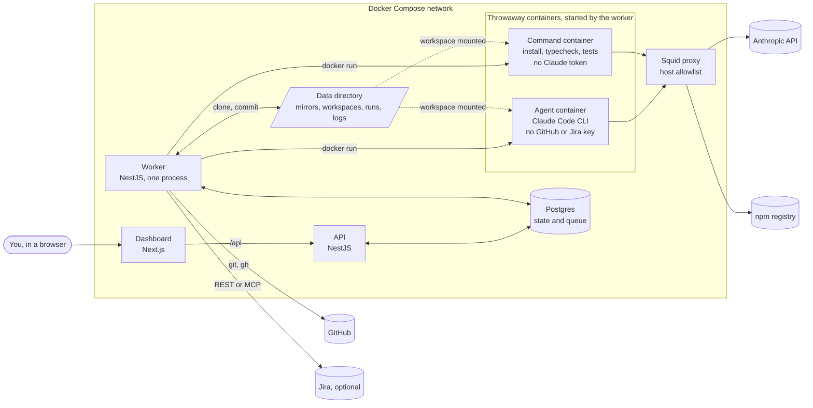
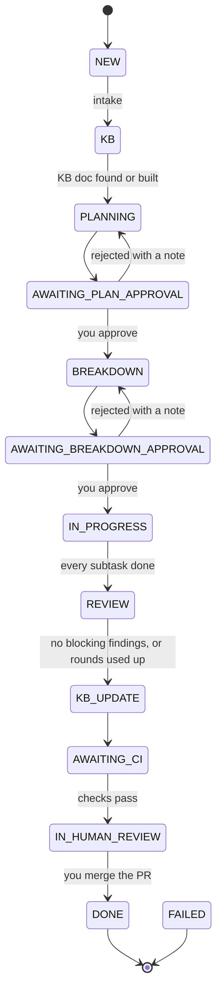
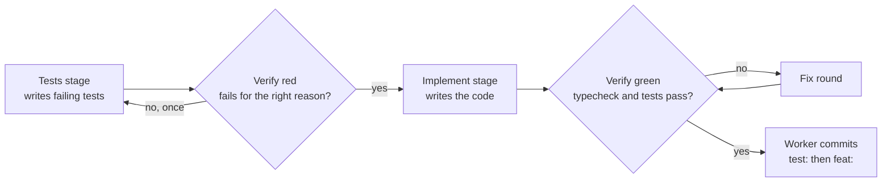
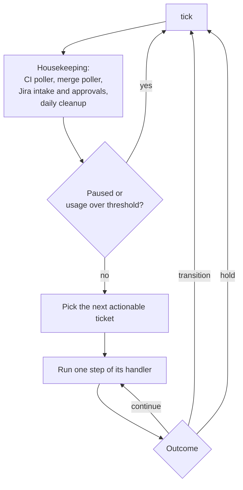
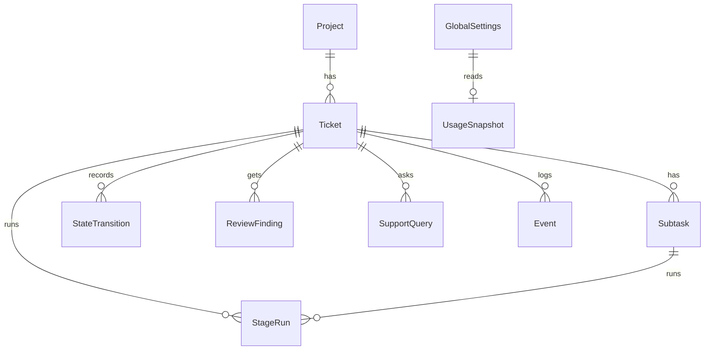

# Architecture

How sdlc-agent is put together, and how that has changed. Read this before changing anything structural. The product spec (what it must do) is [`BUILD_PLAN.md`](../../BUILD_PLAN.md); this document describes what is built.

- Status: **version 1** (all 14 milestones implemented)
- Last reviewed: 2026-11-12
- Diagrams are [Mermaid](https://mermaid.js.org/) so GitHub renders them and a change shows up as a text diff.

## Contents

- [The system in one picture](#the-system-in-one-picture)
- [Trust boundaries](#trust-boundaries)
- [Ticket lifecycle](#ticket-lifecycle)
- [Inside a subtask](#inside-a-subtask)
- [The worker loop](#the-worker-loop)
- [Stages and models](#stages-and-models)
- [Data model](#data-model)
- [Code layout](#code-layout)
- [Design decisions](#design-decisions)
- [Changing this document](#changing-this-document)
- [Architecture change log](#architecture-change-log)

## The system in one picture

| Part | Does | Does not |
| --- | --- | --- |
| Dashboard | Login, queue, approvals, support queries, settings, guidelines, charts | Talk to the database or any outside service |
| API | REST for the dashboard; reads and writes tickets, approvals, settings | Run stages |
| Worker | The only place that runs stages, git, GitHub and Jira calls, polling and housekeeping | Run repository code itself |
| Agent container | Edits files in one workspace for one stage, then exits | Hold GitHub or Jira credentials, commit, or push |
| Command container | Runs install, typecheck and targeted tests | Hold the Claude token or any other credential |
| Proxy | Allows the Anthropic API and the npm registry (port 3128); port 3129 also allows the Jira MCP host | Anything else |

The API and the worker are separate Compose services built from one codebase (`apps/api`). Only the worker mounts the Docker socket.

## Trust boundaries

Ticket text and repository content are untrusted. Each secret lives in exactly one place:

| Secret | Held by | Reaches agent containers? |
| --- | --- | --- |
| Claude token | Worker, passed to agent containers only | Yes, this is the only one |
| GitHub token | Worker (`git` through an askpass helper, `gh`) | No |
| Jira credentials | Worker (REST); Jira MCP mode passes the one referenced credential to the two Jira stages only | Only those two stages, in MCP mode |
| Dashboard password, session secret | API | No |

Agent containers run as a non-root user with all capabilities dropped, `no-new-privileges`, memory, CPU and pid limits, a wall-clock timeout and no Docker socket. Their only network path is the proxy. The worker commits with git hooks disabled (`core.hooksPath=/dev/null`) and `core.fsmonitor=false`, so a workspace's own git config cannot run code in the worker. Logs and API output pass through a redactor.

## Ticket lifecycle

Any working state can move to `ON_HOLD` (not drawn, to keep the picture readable). Resume, and Retry for a `FAILED` ticket, return it to the state it was in (`holdFromStatus`). Hold reasons: `awaiting_answer` (the agent asked a question), `needs_help` (a stage failed twice or hit a limit), `manual` (you paused or killed it), `pr_closed`. Gates, review rounds and the CI fix round are per-project settings. The usage gate pauses the whole pipeline, not one ticket.

Every transition is a row in `StateTransition`, written by one state machine (`apps/api/src/state`). Nothing else changes a ticket's status.

## Inside a subtask

Between stages the worker, not the agent, runs install, typecheck and the targeted tests, checks that test files were not edited during implement (tamper guard), and checks which files changed (commit guard). A stage that fails is retried once, then the ticket goes on hold. A held subtask's Retry restarts the subtask loop only.

## The worker loop

- A Postgres advisory lock allows one worker, and the loop runs one stage at a time system-wide.
- Handlers: plan, breakdown, subtask loop, `ReviewHandler`, `KbUpdateHandler`, `CiFixHandler`, `HumanReviewHandler` (KB re-run on request).
- After every stage the usage gate reads Claude Code's rate-limit event and pauses the pipeline when a window crosses its threshold.
- Pollers: CI status every 30 s, PR merge detection, Jira intake and approvals (REST per project; MCP on its own interval).

## Stages and models

Defaults; all are per-project settings.

| Stage | Model | Produces |
| --- | --- | --- |
| `kbBuild` | Sonnet | A knowledge-base doc for the feature area |
| `plan` | Opus | Goal, approach, tests and scope, for your approval |
| `breakdown` | Haiku | Ordered subtasks with acceptance criteria and dependencies |
| `tests`, `implement` | Sonnet | Failing tests, then the code, per subtask |
| `review` | Sonnet | Up to 10 findings per round, each with file, rule and fix |
| `kbUpdate` | Sonnet | The same doc, corrected to match what was built |
| `jiraIntake`, `jiraSync` | Haiku | Jira reads and writes, MCP mode only |

Stage instructions are markdown files in [`guidelines/stages`](../../guidelines/stages). Each stage is a fresh container with its own model, turn limit and only the context it needs.

## Data model

`Project` holds settings as JSON validated by the schemas in `packages/shared`. `GlobalSettings` holds the pause flag, usage thresholds and calibration. `StageRun` records model, tokens, turns, cost and log path for every run. `Session` backs the dashboard login. The Prisma schema is `apps/api/prisma/schema.prisma`.

## Code layout

| Path | Contents |
| --- | --- |
| `apps/api` | NestJS: REST API, worker, state machine, agent runner, git, GitHub and Jira clients, metrics |
| `apps/dashboard` | Next.js App Router dashboard |
| `apps/e2e` | Playwright suite (own Postgres, built API, dashboard) |
| `packages/shared` | Zod schemas, enums, state machine rules, stage envelope |
| `docker/agent`, `docker/worker`, `docker/proxy` | The three images |
| `guidelines` | Default `CLAUDE.md`, stage prompts, stack guidelines, review checklist |
| `test/fake-claude` | Claude CLI stand-in used by tests |

## Design decisions

1. **Code does what needs no judgment.** Git, GitHub, Jira, test runs, state and scheduling are deterministic code. AI plans, splits, writes tests and code, reviews, and writes docs.
2. **Agents only edit files.** The worker makes every commit, push, PR and Jira call.
3. **One AI stage at a time, system-wide.** Keeps usage predictable and makes the usage gate simple.
4. **Postgres is the queue.** No Redis; the advisory lock and status columns are enough for one worker.
5. **Humans gate three points:** plan, breakdown, merge. There is no auto-merge.
6. **The KB lives in the target repository** and is indexed deterministically, so a stage reads one small doc instead of the codebase.
7. **Strict input at the edge.** Request bodies are validated with Zod; ticket creation rejects unknown fields.

## Changing this document

Update this file in the same pull request when a change does any of the following:

- adds, removes or renames a service, image, or a hop in the diagram above;
- changes who holds a secret or what a container can reach;
- adds or removes a ticket state, hold reason, stage, or housekeeping job;
- changes a decision under [Design decisions](#design-decisions).

Then add a line to the change log, newest first: date, what changed, why, and the PR. Small refactors that keep the pictures true need no entry.

## Architecture change log

| Date | Change | Why | PR |
| --- | --- | --- | --- |
| 2026-11-12 | Agent image creates `/npm-cache` owned by `node`; worker image sets `safe.directory '*'`; worker git calls pass `core.fsmonitor=false` | The first live run failed on cache ownership and on git refusing agent-owned workspaces | #15 |
| 2026-11-12 | Ticket creation rejects unknown fields; `kbUpdate` stage rewrites statements the change made false | A mistyped field silently dropped the ticket body; KB docs kept "does not exist yet" notes | #15 |
| 2026-11-12 | Version 1 complete: milestones 0 to 13 | Initial release | #1 to #16 |
